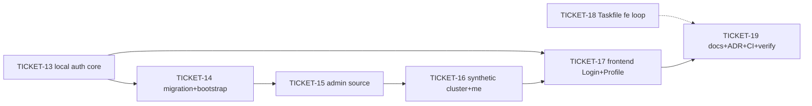

# Tasks — Authentication Vertical

> **STATUS:** `sliced` (2026-10-18)

> Sliced from `.skillgrid/specs/2026-10-17-authentication-vertical/blueprint.md`.
> Vertical tracer-bullet tickets, dependency-ordered, sized for one fresh agent context window.
> Build shape: **Tracer thread** — Wave 1 makes local login work end-to-end (API → DB → JWT → SPA token parking) before the admin source, profile page, and Taskfile loop thicken the vertical.

## Epic Summary

Local password login (bootstrap admin) as a sibling route of the OIDC flow, a real Login page (SSO + password form gated by `/auth/settings`), a `/profile` post-login landing, admin cluster access via in-cluster/kubeconfig-file (synthetic `id: 0` cluster through the existing SAR path), and the offline frontend build/sync loop in the root Taskfile with a no-CDN air-gap check — per ADR-0021 (authored by this change), air-gap-safe per ADR-0020.

## Delivery Strategy

| Field | Value |
|-------|-------|
| Estimated changed lines | ~2,800–3,600 (7 tickets incl. ~35% tests; ADR + docs excluded) |
| 400-line budget risk | High |
| Chained PRs recommended | Yes |
| Suggested split | PR 1 (auth core: TICKET-13+14) → PR 2 (admin source + me growth: TICKET-15+16) → PR 3 (frontend: TICKET-17) → PR 4 (Taskfile loop + docs: TICKET-18+19) |
| Delivery strategy | ask-on-risk |
| Chain strategy | pending (user chooses at execution handoff) |

Decision needed before apply: Yes
Chained PRs recommended: Yes
Chain strategy: pending
400-line budget risk: High

### Suggested Work Units

| Unit | Goal | Likely PR | Focused test command | Runtime harness | Rollback boundary |
|------|------|-----------|----------------------|-----------------|-------------------|
| 1 | Local auth core: routes, error codes, settings, pbkdf2, columns (TICKET-13) + bootstrap hook + migration (TICKET-14) | PR 1 | `cd backend && uv run pytest tests/api/test_local_auth.py tests/test_bootstrap.py tests/api/test_auth.py -v` | Testcontainers PG + sqlite api tier | `backend/app/{core,api,schemas,models}` + `wsgi.py` + `migrations/` — revertable without touching frontend/chart |
| 2 | Admin kubeconfig source (TICKET-15) + synthetic cluster + me growth (TICKET-16) | PR 2 | `cd backend && uv run pytest tests/test_admin_source.py tests/api/test_clusters_admin.py -v` | kind integration tier (CI backstop) | `backend/app/services/k8s_client.py` + `api/{clusters,resources,auth}.py` + `schemas/` |
| 3 | Frontend: Login (SSO + local) + Profile + routes (TICKET-17) | PR 3 | `cd frontend && pnpm test && pnpm exec tsc --noEmit && pnpm lint && pnpm build` | Vitest + MSW | `frontend/src/views/{Login,Profile}` + `App.tsx` + `lib/types.ts` |
| 4 | Taskfile fe loop + no-CDN check (TICKET-18) + docs/ADR bookkeeping/CI (TICKET-19) | PR 4 | `task fe-install fe-build fe-sync fe-check && cd backend && uv run pytest tests/test_fe_airgap_check.py -v` | real bundle + fixture dist/ | `Taskfile.yaml` + `scripts/fe-airgap-check.mjs` + docs |

## Tickets

### TICKET-13 — Local password auth core: routes, error codes, settings, pbkdf2, model columns

- **Tracker ID:** TASK-016 (milestone m-0 "KubeDash 5.0 base structure")
- **Scope:** Blueprint Task 1. `users` model columns (`password_hash`, `auth_source` — model-only; the Alembic revision is TICKET-14); `security.hash_password`/`verify_password` (stdlib pbkdf2:sha256, 600k iters); `InvalidCredentialsError` (401) + `LocalAuthDisabledError` (403) in the v1 error contract; `LocalLoginIn` + `AuthSettingsOut` (marshmallow); `AuthApi.local` + `AuthApi.settings`; `redirect_with_tokens` + `_issue_and_persist` extracted from the OIDC `callback` (both routes share one builder — the door check); conftest amendment (both layers, `_settings` reset order, `client_no_bootstrap`, sqlite tier seeds rows directly).
- **Acceptance:** `uv run pytest tests/api/test_local_auth.py tests/api/test_auth.py -v` green: login 302 exact-match against the issued pair (door check); wrong password + unknown email → 401 `INVALID_CREDENTIALS` (one code); SSO-row-same-email → 401; env unset → 403 `LOCAL_AUTH_DISABLED`; settings open route reflects config; **the OIDC callback test passes with the new exact-match assertion** (shared-builder proof on both sides).
- **SATISFIES:** `local-admin-login-issues-jwt` (T1, T2 half), `login-page-offers-sso-and-local` (settings contract half)
- **Files:** `backend/app/models/user.py`, `backend/app/core/{errors,security,config}.py`, `backend/app/schemas/auth.py`, `backend/app/api/auth.py`, `backend/tests/api/{test_local_auth.py (new), test_auth.py (amend), conftest.py (amend)}` (~9 files, ~650 lines)
- **Size:** ~650 (M)
- **Blocks:** TICKET-14, TICKET-17
- **Blocked by:** none
- **Reversibility:** one-way — OD-B (two new stable error codes enter the v1 error contract) + OD-C (`/auth/settings` open route widens the pre-JWT scope); human checkpoint
- **Fails-when:** `pytest` exit ≠ 0, or the OIDC callback test's exact-match assertion fails (the door check failed — stop)

### TICKET-14 — Migration + bootstrap boot hook

- **Tracker ID:** TASK-017 (milestone m-0)
- **Scope:** Blueprint Task 2. Alembic revision (additive: `password_hash`, `auth_source`, **`uq_users_email` unique constraint**); `_bootstrap_local_admin(app)` — true PG upsert (`ON CONFLICT (email) DO UPDATE` with the case-gated `auth_source`/`password_hash` SSO-collision rule), own app context, called from `wsgi.py` after `create_app()` (factory stays pure); test fixtures invoke it post-`create_all` (PG tier only — the sqlite api tier skips it); the SSO-collision test (callback as bootstrap email → `auth_source='oidc'` wins, hash UNCHANGED, subsequent local login 401).
- **Acceptance:** `uv run pytest tests/test_bootstrap.py tests/test_models.py tests/api/test_auth.py -v` green: boot creates exactly one admin row (`sub=local:admin@local`, role `admin`, `auth_source='local'`); second boot no duplicate; password env change updates the hash (local rows only); env unset → no-op; SSO collision → oidc wins + password stops working (401); migration contains the unique constraint.
- **SATISFIES:** `local-admin-login-issues-jwt` (T3 half), `adr-0021-local-mode-in-force` (schema half), `oidc-login-still-issues-jwt` (collision half)
- **Files:** `backend/migrations/versions/<newrev>_local_admin_auth_adr_0021.py` (new), `backend/wsgi.py`, `backend/app/__init__.py`, `backend/app/models/user.py` (comment), `backend/tests/{test_bootstrap.py (new), test_models.py (amend)}, backend/tests/api/test_auth.py` (collision amendment) (~7 files, ~500 lines)
- **Size:** ~500 (M)
- **Blocks:** TICKET-15
- **Blocked by:** TICKET-13
- **Reversibility:** one-way — OD-A (additive migration + `uq_users_email` constraint; `auth_source NOT NULL DEFAULT 'oidc'` declares existing rows SSO); human checkpoint before running the migration locally
- **Fails-when:** `pytest` exit ≠ 0, or `grep -c "uq_users_email"` on the new revision < 1

### TICKET-15 — Admin kubeconfig source in the client pool

- **Tracker ID:** TASK-018 (milestone m-0)
- **Scope:** Blueprint Task 3. `resolve_admin_source(s)` (pure); `build_admin_client(s)` (file → `load_kube_config`, empty → in-cluster; file-missing → `ValueError`); `K8sClientPool(admin_factory=...)` + `_get_admin_client_for(user)` (lazy, cached, role gate) + **the `cluster.id == 0` branch INSIDE `pool.get`** (so `rbac.py:77`'s SAR path converges unchanged); the `source` attribute; the `id: 0` short-circuit in `api/clusters.py` (`get_cluster`, `cluster_health`) + `api/resources.py` (`list_resources`) — synthetic `Cluster(id=0)` BEFORE `bound_cluster_or_404`; readyz `admin-kubeconfig` probe (probe-not-resolver invariant); conftest `_settings` reset for env-changing tests.
- **Acceptance:** `uv run pytest tests/test_admin_source.py tests/api/test_clusters.py tests/api/test_resources.py tests/services/test_rbac.py tests/tasks/ -v` green: `resolve_admin_source` pure; role gate (fake factory — no real k8s load); admin `id:0` pod list (integration, kind, env-blocked locally); non-admin `id:0` → 404 `CLUSTER_NOT_FOUND`; readyz 503 naming `admin-kubeconfig` on missing file; readyz no `admin-kubeconfig` key when empty; **existing cluster/resource/rbac/task suites green** (the `id>0` regression guard).
- **SATISFIES:** `admin-sees-local-cluster-from-config` (pool half, T7, T9)
- **Files:** `backend/app/services/k8s_client.py`, `backend/app/api/{clusters,resources}.py`, `backend/app/__init__.py` (readyz), `backend/tests/conftest.py` (amend), `backend/tests/test_admin_source.py` (new) (~6 files, ~600 lines)
- **Size:** ~600 (M)
- **Blocks:** TICKET-16, TICKET-17
- **Blocked by:** TICKET-14
- **Fails-when:** `pytest` exit ≠ 0, or any existing cluster/resource/rbac test regresses

### TICKET-16 — Synthetic `local` cluster in the list + `me` response growth

- **Tracker ID:** TASK-019 (milestone m-0)
- **Scope:** Blueprint Task 4. `_out()` + `source: "registry"` (the bare-jsonify list — the handler dict, not just the schema); `list_clusters` prepends the synthetic admin entry (`id: 0`, `api_server` from the resolved source — the path, not the literal); `MeOut` growth in **marshmallow** (`auth_source`, `kubeconfig_source`, `last_login_at`); `me` handler populates them; **OpenAPI re-dump** (`frontend/openapi.json` from the test client — the source for TICKET-17's `types.ts`).
- **Acceptance:** `uv run pytest tests/api/test_clusters_admin.py tests/api/test_auth.py -v -m "not integration"` green: admin list has exactly one `id:0 source:admin` entry with the correct `api_server`; non-admin list unchanged; admin `me` has `auth_source`+`kubeconfig_source`+`last_login_at`; user `me` has `kubeconfig_source: null`; `frontend/openapi.json` re-dumped and matches the grown `MeOut`.
- **SATISFIES:** `admin-sees-local-cluster-from-config` (T6, T8), `profile-page-shows-identity` (backend half)
- **Files:** `backend/app/api/{clusters,auth}.py`, `backend/app/schemas/{cluster,auth}.py`, `frontend/openapi.json` (re-dump), `backend/tests/api/test_clusters_admin.py` (new), `backend/tests/api/test_auth.py` (amend) (~7 files, ~450 lines)
- **Size:** ~450 (S/M)
- **Blocks:** TICKET-17
- **Blocked by:** TICKET-15
- **Reversibility:** one-way — OD-D (reserved cluster id 0 in the cluster namespace, visible to admins); human checkpoint
- **Fails-when:** `pytest` exit ≠ 0, or the re-dumped openapi.json lacks the three new `me` fields

### TICKET-17 — Frontend: Login (SSO + local) + Profile + routes

- **Tracker ID:** TASK-020 (milestone m-0)
- **Scope:** Blueprint Task 5. Login view REWRITE: parking effect → `navigate('/profile', {replace: true})` (react-router); mount auto-bounce REMOVED; settings `useQuery` (fail-open on error → both options); SSO button iff `sso_enabled` (document navigation, unchanged mechanism); local form iff `local_enabled` — `fetch(..., redirect: 'follow')`, parse `res.url` on success (in-process, no document navigation), park + navigate; 401/403 envelope inline. Profile view: identity card (name, email, groups, role badge, auth-source badge, last login) + logout (POST → clear both keys → `/login`). `App.tsx`: `/profile` route inside `DefaultLayout` + `ProtectedRoute` (lazy). `types.ts`: `Me` growth cross-checked against the re-dumped `openapi.json`.
- **Acceptance:** `cd frontend && pnpm test && pnpm exec tsc --noEmit && pnpm lint && pnpm build` all exit 0: token-in-URL parks + lands on `/profile` (router-moved assertion); local form success parses the 302 + parks + navigates; SSO button iff `sso_enabled`; local form iff `local_enabled`; 401 surfaces inline; settings-failure fail-open; Profile renders me-fields + role/auth badges; logout clears storage + navigates.
- **SATISFIES:** `login-page-offers-sso-and-local` (T10), `profile-page-shows-identity` (T11)
- **Files:** `frontend/src/views/Login/index.tsx` (rewrite), `frontend/src/views/Profile/index.tsx` (new), `frontend/src/App.tsx`, `frontend/src/lib/types.ts`, `frontend/tests/views/{Login,Profile}.test.tsx` (new) (~7 files, ~700 lines)
- **Size:** ~700 (M)
- **Blocks:** TICKET-19 (verification)
- **Blocked by:** TICKET-13 (settings + local contracts), TICKET-16 (me growth + openapi re-dump)
- **Fails-when:** any of `pnpm test` / `tsc --noEmit` / `pnpm lint` / `pnpm build` exit ≠ 0

### TICKET-18 — Taskfile frontend loop + no-CDN air-gap check

- **Tracker ID:** TASK-021 (milestone m-0)
- **Scope:** Blueprint Task 6. `scripts/fe-airgap-check.mjs` (plain ESM walker: `https?://` + `//cdn.` regexes, allow-list substring skip, `file:line: url` offenders, exit 1/0; binary scan = `.svg` only) **with the pre-flight over the current `frontend/dist` pinning the default allow-list** (known suspect: `http://www.w3.org/2000/svg` xmlns); root `Taskfile.yaml` +`fe-install` / `fe-build` (quoted `&&` cmd) / `fe-sync` (rm+cp, recovery note) / `fe-dev` (`VITE_API_BASE`) / `fe-check` (deps `[fe-build]` + the script, `ALLOW` optional); `.gitignore` +`backend/static/`.
- **Acceptance:** `cd backend && uv run pytest tests/test_fe_airgap_check.py -v` green (clean dist passes; `https://cdn.example.com` fails with the offender printed; `//cdn.` fails; `--allow` overrides) AND `task fe-install fe-build fe-sync fe-check` ends with `backend/static/index.html` present + `fe-check` exit 0 on the real bundle.
- **SATISFIES:** `taskfile-fe-loop-serves-offline-bundle` (T12, T13, T14)
- **Files:** `scripts/fe-airgap-check.mjs` (new), `Taskfile.yaml` (amend), `.gitignore` (amend), `backend/tests/test_fe_airgap_check.py` (new) (~4 files, ~300 lines)
- **Size:** ~300 (S)
- **Blocks:** TICKET-19
- **Blocked by:** none (pure tooling — parallel in Wave 1)
- **Fails-when:** `pytest` exit ≠ 0, or `task fe-check` exit ≠ 0 on the real bundle, or `backend/static/index.html` missing after `fe-sync`

### TICKET-19 — Docs, ADR bookkeeping, CI wiring, acceptance + full verification

- **Tracker ID:** TASK-022 (milestone m-0)
- **Scope:** Blueprint Task 7. `ASSUMPTIONS.md` (LOCKED +0021 row, ADR-0020 annotation, sequence → 0021); `.backlog/decisions/decision-021.md` (ADR copy); `README.md` (quickstart fe-loop + 3 env vars + the `task fe-dev` not bare `pnpm dev` note); `ARCHITECTURE.md` §11 (bootstrap-admin implemented note); `ci.yaml` frontend job +`node scripts/fe-airgap-check.mjs frontend/dist` after `pnpm build`; `state.yaml` phase update; L3 full verification (backend ruff+mypy+pytest, frontend four gates, go, helm, grep cross-checks).
- **Acceptance:** the full-suite verification commands all green or explicitly recorded environment-blocked (Docker-dependent = CI backstop); `grep -c "0021" .skillgrid/ASSUMPTIONS.md` ≥ 2; the SATISFIES scenario-name cross-check passes (7 unique names, one per task).
- **SATISFIES:** `adr-0021-local-mode-in-force`, all scenario-name cross-checks
- **Files:** `.skillgrid/ASSUMPTIONS.md`, `.backlog/decisions/decision-021.md`, `README.md`, `.skillgrid/ARCHITECTURE.md`, `.github/workflows/ci.yaml`, `.skillgrid/state.yaml`, `.skillgrid/specs/2026-10-17-authentication-vertical/acceptance.feature` (~7 files, ~250 lines)
- **Size:** ~250 (S)
- **Blocks:** none (final)
- **Blocked by:** TICKET-17, TICKET-18 (verifies the assembled surface)
- **Fails-when:** any verification command exit ≠ 0 without a recorded environment-block note

## Dependency Graph

## Execution Order

- **Wave 1 (parallel):** TICKET-13 (auth core — the door check), TICKET-18 (Taskfile loop — pure tooling, independent)
- **Wave 2:** TICKET-14 (migration + bootstrap, after TICKET-13)
- **Wave 3:** TICKET-15 (admin source, after TICKET-14)
- **Wave 4:** TICKET-16 (synthetic cluster + me, after TICKET-15)
- **Wave 5 (parallel):** TICKET-17 (frontend, after TICKET-13+16), TICKET-19 (docs + verify, after TICKET-17+18)

> **Acceptance-first (BDD is always on):** `acceptance.feature` is committed alongside
> this file (7 scenarios — the exact names every ticket's SATISFIES line references);
> each executor confirms its `SATISFIES` scenario RED via the ticket's test step
> (Step 2 of every blueprint task) before the implementation that turns it green.

## Slicing Notes

- **Tracer thread honored:** Wave 1 (TICKET-13) makes local login work end-to-end
  against the existing spine (API → DB → JWT → 302 contract) before the admin
  source, profile page, and Taskfile loop thicken the vertical. The door check
  (TICKET-13's exact-match redirect test + the unmodified OIDC test) is the
  first-wave risk de-risk.
- **TICKET-18 is parallel-in-Wave-1 by design:** pure tooling (script + Taskfile +
  gitignore), zero shared files with TICKET-13 — the base-structure pattern
  (TICKET-11 CLI ran parallel in Wave 1 for the same reason).
- **One-way checkpoints:** TICKET-13 (OD-B+OD-C), TICKET-14 (OD-A), TICKET-16
  (OD-D) — each inserts a human checkpoint per the execution contract.
- **Classification:** high-risk (auth trust boundary + additive migration) →
  L3+ verification (TICKET-19 Step 4) and the final review escalates to
  `parallel-code-review` per the rigor tiers.
- **Cross-change dependency (outgoing):** the in-flight
  `2026-10-17-kubectl-oidc-plugin` change consumes the auth spine this change
  extends — its `api/kubectl_auth.py` stub registration point is untouched
  (the `/api/v1/kubectl/` authhook skip is unchanged).
