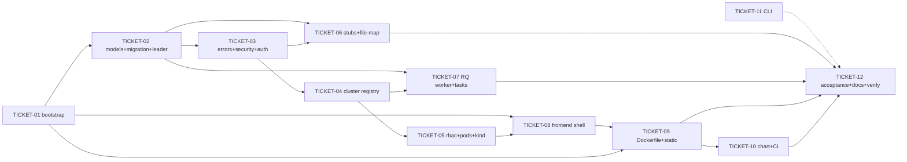

# Tasks — KubeDash 5.0 Base Structure

> **STATUS:** `sliced` (2026-10-17)

> Sliced from `.skillgrid/specs/2026-10-17-kubedash-base-structure/blueprint.md`.
> Vertical tracer-bullet tickets, dependency-ordered, sized for one fresh agent context window.
> Build shape: **Tracer thread** — Wave 1 lays the end-to-end spine (boot → auth → cluster → pods → SPA); later waves thicken it (stubs, worker, image, chart, CLI, docs).

## Epic Summary

Materialize the KubeDash 5.0 monorepo skeleton per ARCHITECTURE.md §2: a
tested tracer spine (Flask-Smorest app factory, OIDC auth, encrypted cluster
registry, pod listing with SAR, CoreUI SPA) plus ADR-pointing stubs for every
other module, a single-container image, a Helm chart, a Go CLI skeleton, and
green CI. The in-flight kubectl-oidc-plugin change can start its slice after
TICKET-01..03 land.

## Delivery Strategy

| Field | Value |
|-------|-------|
| Estimated changed lines | ~4,000–5,500 (12 blueprint tasks incl. ~40% tests; frontend template copy excluded from count) |
| 400-line budget risk | High |
| Chained PRs recommended | Yes |
| Suggested split | PR 1 (backend spine) → PR 2 (stubs + worker) → PR 3 (frontend + image) → PR 4 (chart + CI + CLI + docs) |
| Delivery strategy | ask-on-risk |
| Chain strategy | pending (user chooses at execution handoff) |

Decision needed before apply: Yes
Chained PRs recommended: Yes
Chain strategy: pending
400-line budget risk: High

### Suggested Work Units

| Unit | Goal | Likely PR | Focused test command | Runtime harness | Rollback boundary |
|------|------|-----------|----------------------|-----------------|-------------------|
| 1 | Backend spine: boot, models+migration, auth, clusters, pods (blueprint Tasks 1–5) | PR 1 | `cd backend && uv run pytest -m "not integration"` | Testcontainers PG+Redis; kind for the 2 integration tests | `backend/app/{api,models,services,core}` + `backend/tests` — revertable without touching frontend/chart |
| 2 | Stub surface + file-map guard + leader-gated RQ worker (Tasks 6–7) | PR 2 | `cd backend && uv run pytest tests/test_file_map.py tests/test_worker_gate.py tests/api/test_stubs.py` | Testcontainers + real PG advisory lock | `backend/app/{api,models,services,tasks,sockets,aggregated}` stub files + `wsgi.py` worker block |
| 3 | SPA shell + single-container image (Tasks 8–9) | PR 3 | `cd frontend && pnpm test && pnpm build && docker build -f backend/Dockerfile .` | Flask-served bundle + Playwright smoke; Docker build | `frontend/` + `backend/Dockerfile` + `register_static` |
| 4 | Helm chart + CI/CD + CLI skeleton + acceptance/docs (Tasks 10, 11, 12) | PR 4 | `helm lint charts/kubedash && helm template t charts/kubedash && cd cli && go test ./...` | helm binary; Go toolchain; GitHub Actions dry-run | `charts/` + `.github/workflows/` + `cli/` + `e2e/oidc-mock.py` |

## Tickets

### TICKET-01 — Backend bootstrap: app factory, config, health probes, test infra

- **Tracker ID:** TASK-002 (milestone m-0 "KubeDash 5.0 base structure")
- **Scope:** Blueprint Task 1 + Task 10's conftest fixture layer. `backend/` uv project, `create_app()`, Pydantic `Settings` (incl. the two §7.5 keys), extensions, `/healthz` + `/readyz`, OpenAPI check; Testcontainers PG/Redis + `app`/`client` fixtures + `pytest` markers.
- **Acceptance:** `uv run pytest tests/ -v` green (4+ tests): app constructs; `/healthz` 200; `/readyz` 200 with deps up, 503 naming "redis" when down; `/api/openapi.json` valid OpenAPI 3.0.
- **SATISFIES:** `app-boots-and-health-probes-report`, `test-fixtures-boot`
- **Files:** `backend/pyproject.toml`, `backend/app/{__init__,extensions}.py`, `backend/app/core/{__init__,config}.py`, `backend/wsgi.py`, `backend/tests/{conftest.py,test_app.py,test_health.py}` (~10 files, ~600 lines)
- **Size:** ~600 (M)
- **Blocks:** TICKET-02, TICKET-03, TICKET-04, TICKET-05, TICKET-08, TICKET-09
- **Blocked by:** none

### TICKET-02 — Core models, initial migration, leader election

- **Tracker ID:** TASK-003 (milestone m-0)
- **Scope:** Blueprint Task 2. `users`, `clusters` (incl. `last_probe_at`), `cluster_bindings`, `refresh_tokens`, `leader_lease` models; initial Alembic revision; `Leader` (per-replica advisory lock key, stale takeover, failover test).
- **Acceptance:** `uv run pytest tests/test_models.py tests/test_leader.py -v` green: binding role validation raises on unknown role; single replica leads; second replica does not double-lead; failover after leader stop ≤ 15 s (test budget with `stale_seconds=1`). Migration file contains all five `create_table` calls.
- **SATISFIES:** `app-boots-and-health-probes-report` (leader status in readyz)
- **Files:** `backend/app/models/{__init__,user,cluster,binding,token,leader_lease}.py`, `backend/app/core/leader.py`, `backend/migrations/`, `backend/tests/{test_models.py,test_leader.py}` (~9 files, ~700 lines)
- **Size:** ~700 (M)
- **Blocks:** TICKET-03, TICKET-06, TICKET-07
- **Blocked by:** TICKET-01
- **Reversibility:** one-way — OD-3 initial v1 migration; human checkpoint before running `flask db migrate`
- **Fails-when:** `pytest` exit ≠ 0, or `grep -c create_table` on the new revision < 5

### TICKET-03 — v1 error contract + JWT/OIDC security core + auth API

- **Tracker ID:** TASK-004 (milestone m-0)
- **Scope:** Blueprint Task 3. `KubeDashHttpError` hierarchy (8 stable codes), `security.py` (Authlib `oidc_authorize_url(state)`/`oidc_exchange` real bodies, `issue_token_pair`, `verify_jwt` with jti revocation set, `rotate_refresh` delete-on-consume, state round-trip), `AuthApi` (login/callback/refresh/logout/me), JWT delivery contract (`302 → /?token=…&refresh=…`), MockOIDC test pair.
- **Acceptance:** `uv run pytest tests/api/test_auth.py tests/test_errors.py -v` green: login→me echoes `sub`; state mismatch → 400 `STATE_MISMATCH`; no JWT → 401 stable shape; expired JWT → 401; refresh reuse → 401 **and consumed row deleted**; error envelope shape on any error.
- **SATISFIES:** `oidc-login-issues-jwt`
- **Files:** `backend/app/core/{errors,security}.py`, `backend/app/schemas/{__init__,errors,auth}.py`, `backend/app/api/{auth.py,__init__.py}`, `backend/tests/{test_errors.py,api/conftest.py,api/test_auth.py}` (~8 files, ~800 lines)
- **Size:** ~800 (M)
- **Blocks:** TICKET-04, TICKET-05, TICKET-06
- **Blocked by:** TICKET-02
- **Reversibility:** one-way — OD-1 v1 error envelope + stable codes; human checkpoint
- **Fails-when:** `pytest` exit ≠ 0

### TICKET-04 — Cluster registry: encrypted kubeconfig + client pool + binding gate

- **Tracker ID:** TASK-005 (milestone m-0)
- **Scope:** Blueprint Task 4. AES-256-GCM `encrypt/decrypt_kubeconfig`, `bound_cluster_or_404`, `K8sClient` (host verbatim, CA from kubeconfig, 5 s `readyz`), `K8sClientPool`, `ClusterApi` (register/list/get/health, 409/422/502 paths), blackholed-server timeout test.
- **Acceptance:** `uv run pytest tests/test_encryption.py tests/api/test_clusters.py -v -m "not integration"` green: at-rest bytes hide plaintext + round-trip; wrong key fails; register→list shows bound cluster; dup name 409; bad yaml 422; unbound user sees `[]`; blackholed port → 502 `CLUSTER_UNREACHABLE` < 8 s; `readyz` URL/CA unit assertions.
- **SATISFIES:** `cluster-register-and-health`
- **Files:** `backend/app/services/{__init__,k8s_client}.py`, `backend/app/schemas/cluster.py`, `backend/app/api/clusters.py`, `backend/app/api/__init__.py` (modify), `backend/pyproject.toml` (+cryptography), `backend/tests/{test_encryption.py,api/test_clusters.py}` (~7 files, ~750 lines)
- **Size:** ~750 (M)
- **Blocks:** TICKET-05
- **Blocked by:** TICKET-03
- **Reversibility:** one-way — OD-2 AES-256-GCM registry (ADR-0002); human checkpoint
- **Fails-when:** `pytest` exit ≠ 0, or `test_health_blackholed_server_times_out_bounded` > 8 s

### TICKET-05 — RBAC SAR service + generic pod list + kind integration tier

- **Tracker ID:** TASK-006 (milestone m-0)
- **Scope:** Blueprint Task 5. `services/rbac.py` `can()` (SAR, 30 s Redis cache, `_sar_allowed` seam), `ResourceApi` with `_KINDS = {"pods": …}` table, kind fixtures (session create + per-test-file boundary, `kind_client`), integration tests (list pods, SAR denial 403).
- **Acceptance:** `uv run pytest tests/services/test_rbac.py tests/api/test_resources.py -v -m "not integration"` green (unknown kind 404 stable code; unbound 404; cache-hit never reaches pool); with kind: `uv run pytest tests/api/test_resources.py -m integration` green (test pod listed; SAR-denied user → 403 `RBAC_DENIED`).
- **SATISFIES:** `list-pods-for-bound-cluster`
- **Files:** `backend/app/services/rbac.py`, `backend/app/schemas/resource.py`, `backend/app/api/resources.py`, `backend/app/api/__init__.py` (modify), `backend/tests/conftest.py` (append kind fixtures), `backend/tests/{services/test_rbac.py,api/test_resources.py}` (~7 files, ~700 lines)
- **Size:** ~700 (M)
- **Blocks:** TICKET-08 (frontend consumes the contract)
- **Blocked by:** TICKET-04
- **Fails-when:** `pytest` exit ≠ 0

### TICKET-06 — ADR-pointing stub surface + file-map guard

- **Tracker ID:** TASK-007 (milestone m-0)
- **Scope:** Blueprint Task 6. All remaining `backend/app/` paths from ARCHITECTURE.md §2 as stubs (10 API stubs incl. scim/, 5 model stubs, 10 service stubs, 4 task stubs, sockets/logs, aggregated/ service layer, `api/kubectl_auth.py` + `schemas/kubectl_auth.py` stubs), `app/api/_authhook.py` (`apply_auth`), file-map parametrized guard, 501 stub route tests.
- **Acceptance:** `uv run pytest tests/test_file_map.py tests/api/test_stubs.py -v` green: every §2 `backend/app/` path exists; `/api/v1/logs/query`, `/metrics/query`, `/traces` → 501 `NOT_IMPLEMENTED` with JWT.
- **SATISFIES:** `stub-surface-matches-architecture`
- **Files:** ~30 new stub files + `backend/app/api/_authhook.py` + `backend/tests/{test_file_map.py,api/test_stubs.py}` (~33 files, ~800 lines)
- **Size:** ~800 (M)
- **Blocks:** none (the in-flight kubectl-oidc-plugin change consumes `api/kubectl_auth.py`'s registration point)
- **Blocked by:** TICKET-03 (needs `NotImplementedError_` + `apply_auth` pattern), TICKET-02
- **Fails-when:** `pytest` exit ≠ 0, or any parametrized path assertion fails

### TICKET-07 — Leader-gated RQ worker + real cluster_sync/health tasks

- **Tracker ID:** TASK-008 (milestone m-0)
- **Scope:** Blueprint Task 7. `wsgi.py` worker thread + leader-checked scheduler loop (`INTERVALS`, `work(timeout=5)`), `tasks/health.py` + `tasks/cluster_sync.py` real probe implementations (exception-safe, `last_probe_at`), job-execution test.
- **Acceptance:** `uv run pytest tests/test_worker_gate.py tests/tasks/ -v` green: follower → no worker thread; leader candidate → daemon worker thread; enqueued `app.tasks.health.run` executes via `work_one()`; health task marks unreachable cluster `down` (exception caught) and live cluster `up` with `last_probe_at` set.
- **SATISFIES:** `app-boots-and-health-probes-report` (leader status)
- **Files:** `backend/wsgi.py` (replace), `backend/app/tasks/{__init__,cluster_sync,health}.py`, `backend/tests/{test_worker_gate.py,tasks/test_health.py}` (~6 files, ~450 lines)
- **Size:** ~450 (S/M)
- **Blocks:** none
- **Blocked by:** TICKET-02 (Leader), TICKET-04 (pool)
- **Fails-when:** `pytest` exit ≠ 0

### TICKET-08 — Frontend: CoreUI scaffold + SPA shell + three views + api client

- **Tracker ID:** TASK-009 (milestone m-0)
- **Scope:** Blueprint Task 8. CoreUI free admin template copy + KubeDash deps; `lib/api.ts` (JWT attach, single-in-flight 401 refresh, rotated `kd_refresh` storage, error envelope); `lib/types.ts` (openapi-typescript); `store/cluster.ts`; `hooks/useCluster.ts`; `views/{Login,Clusters,Cluster}` (token-in-URL consumption, CTable lists, pod table); MSW tests (incl. double-rotation) + pinned export names; `playwright.config.ts` + `e2e/smoke.spec.ts`.
- **Acceptance:** `pnpm test` green (api attach/refresh/double-rotation/envelope + both view tests); `pnpm exec tsc --noEmit` + `pnpm lint` + `pnpm build` all exit 0; `dist/` contains hashed assets.
- **SATISFIES:** `spa-shell-renders-cluster-pods`
- **Files:** `frontend/` (template + ~12 new/modified src files + tests) (~25 files, ~1,200 lines excl. template)
- **Size:** ~1,200 (L — template copy is mechanical; the authored surface is ~M)
- **Blocks:** TICKET-09 (image bakes `dist/`)
- **Blocked by:** TICKET-01 (conventions/env), TICKET-05 (endpoint contract + types source)
- **Fails-when:** any of `pnpm test` / `tsc --noEmit` / `pnpm lint` / `pnpm build` exit ≠ 0

### TICKET-09 — Single-container Dockerfile + SPA static serving

- **Tracker ID:** TASK-010 (milestone m-0)
- **Scope:** Blueprint Task 9. `register_static` (idempotency-guarded catch-all, immutable assets / no-cache index), 3-stage Dockerfile (node build → uv deps → runtime, non-root 10001, HEALTHCHECK, `GUNICORN_WORKERS/THREADS` env in CMD, sync workers), `.dockerignore`, static tests (`static_app` fixture), Dockerfile grep test.
- **Acceptance:** `uv run pytest tests/test_static.py tests/test_dockerfile.py -v` green (root + fallback serve index; assets immutable; `/api/v1/clusters` not shadowed; USER 10001; no unquoted `$()` in RUN); `docker build -f backend/Dockerfile -t kubedash:base-structure .` exits 0 (record if Docker unavailable in env — CI carries T12).
- **SATISFIES:** `chart-renders-deployment-with-replica-id` (image half), `spa-shell-renders-cluster-pods` (serving half)
- **Files:** `backend/Dockerfile`, `.dockerignore`, `backend/app/__init__.py` (modify `register_static`), `backend/tests/{test_static.py,test_dockerfile.py}` (~5 files, ~350 lines)
- **Size:** ~350 (S)
- **Blocks:** TICKET-10 (chart points at the image)
- **Blocked by:** TICKET-08 (`dist/`), TICKET-01
- **Reversibility:** one-way — OD-4 catch-all ordering + asset cache headers (ADR-0006); human checkpoint
- **Fails-when:** `pytest` exit ≠ 0, or `docker build` exit ≠ 0 (when Docker available)

### TICKET-10 — Helm chart + CI/CD workflows + e2e mock OIDC

- **Tracker ID:** TASK-011 (milestone m-0)
- **Scope:** Blueprint Task 10. `charts/kubedash/` (Chart, values §7.2 subset + §7.5 two keys, templates: Deployment with Downward-API `KUBEDASH_REPLICA_ID` + `KUBEDASH_ROLE=leader` + `GUNICORN_WORKERS/THREADS` + tuning env, Service, ConfigMap, Secret); `ci.yaml` (backend/frontend/cli/chart/image+Trivy/actionlint jobs); `e2e.yaml` (kind + helm + oidc-mock + Playwright); `e2e/oidc-mock.py`; `test_chart.py` template assertions.
- **Acceptance:** `uv run pytest tests/test_chart.py -v` green (Downward API fieldRef; `KUBEDASH_ROLE=leader`; issuer/clientId/image rendered; gunicorn 8/3 rendered; two tuning keys present); `helm lint` + `helm template` exit 0; both workflow YAMLs pass actionlint; `ci.yaml` green on the change branch (record if CI cannot run locally — the merge commit is the backstop).
- **SATISFIES:** `chart-renders-deployment-with-replica-id`, `ci-green-on-base-structure`
- **Files:** `charts/kubedash/*` (6 files), `.github/workflows/{ci,e2e}.yaml`, `e2e/oidc-mock.py`, `backend/tests/test_chart.py` (~10 files, ~700 lines)
- **Size:** ~700 (M)
- **Blocks:** none
- **Blocked by:** TICKET-09 (image contract: port, /healthz, env names)
- **Fails-when:** `helm lint`/`helm template`/`pytest`/`actionlint` exit ≠ 0

### TICKET-11 — Go CLI skeleton

- **Tracker ID:** TASK-012 (milestone m-0)
- **Scope:** Blueprint Task 11. `cli/` Go module (1.22), cobra root + `version` (real, ldflags-overridable) + `get-token`/`clean`/`setup` (exit-2 stubs pointing at the in-flight plugin blueprint), `Taskfile.yaml` (go-task: build + 5-combo cross), `.krew.yaml`.
- **Acceptance:** `cd cli && go vet ./... && go test ./... && task build && ./kubedash version` → `kubedash 0.1.0`; `./kubedash get-token` exits 2 with the pointer message, no panic.
- **SATISFIES:** `cli-version-prints`
- **Files:** `cli/{main.go,go.mod,Taskfile.yaml,.krew.yaml}`, `cli/cmd/{root,version,get_token,clean,setup}.go`, `cli/cmd/version_test.go` (~10 files, ~300 lines)
- **Size:** ~300 (S)
- **Blocks:** none
- **Blocked by:** none (parallel in Wave 1)
- **Fails-when:** `go test` exit ≠ 0, or version output ≠ `kubedash 0.1.0`, or get-token exit ≠ 2

### TICKET-12 — acceptance.feature + root docs + full-suite verification

- **Tracker ID:** TASK-013 (milestone m-0)
- **Scope:** Blueprint Task 12. `acceptance.feature` (1 Feature, 10 scenarios — the exact scenario names every ticket's SATISFIES line references); root `README.md` (5.0 layout, per-component quickstart, env table); `.gitignore` 5.0 additions; L2 full verification pass (backend full suite, frontend four gates, go, helm, docker); `state.yaml` → `slicing` (post-tasks) / execution phase.
- **Acceptance:** all 10 scenario names in `acceptance.feature` match the SATISFIES references in this file exactly (grep cross-check); `pytest backend/tests` (full, integration if kind present), `pnpm test/tsc/lint/build`, `go vet+test+build`, `helm lint+template`, `docker build` all green or explicitly recorded as environment-blocked in task notes; README renders the layout tree.
- **SATISFIES:** (closes all remaining scenario references; `test-fixtures-boot` final pass)
- **Files:** `.skillgrid/specs/2026-10-17-kubedash-base-structure/acceptance.feature`, `README.md`, `.gitignore`, `.skillgrid/state.yaml` (~4 files, ~250 lines)
- **Size:** ~250 (S)
- **Blocks:** none (final)
- **Blocked by:** TICKET-06, TICKET-07, TICKET-09, TICKET-10 (verifies the assembled surface)
- **Fails-when:** any verification command exit ≠ 0 without a recorded environment-block note

## Dependency Graph

## Execution Order

- **Wave 1 (parallel):** TICKET-01, TICKET-11 (CLI is independent of the Python/React spine — runs in its own worktree)
- **Wave 2:** TICKET-02 (after TICKET-01)
- **Wave 3:** TICKET-03 (after TICKET-02)
- **Wave 4 (parallel):** TICKET-04 (after TICKET-03), TICKET-06 (after TICKET-02+03)
- **Wave 5 (parallel):** TICKET-05 (after TICKET-04), TICKET-07 (after TICKET-02+04)
- **Wave 6:** TICKET-08 (after TICKET-01+05)
- **Wave 7:** TICKET-09 (after TICKET-08)
- **Wave 8 (parallel):** TICKET-10 (after TICKET-09), TICKET-12 (after TICKET-06+07+09+10)

> **Acceptance-first (BDD is always on):** `acceptance.feature` is written in
> TICKET-12 (the blueprint keeps the scenario text there); each executor
> confirms its `SATISFIES` scenario RED via the ticket's test step (Step 2 of
> every blueprint task) before the implementation that turns it green. If the
> team prefers the feature file earlier, promote TICKET-12's
> acceptance.feature step into Wave 1 as a 5-minute sub-step of TICKET-01 —
> the scenario NAMES are frozen by this file's SATISFIES lines either way.

## Slicing Notes

- **Tracer thread honored:** Waves 1–5 produce the complete backend spine
  (login → cluster → pods with SAR) before the frontend thickens in Wave 6;
  the SPA's first render is against the real spine, not placeholders.
- **TICKET-08 split rationale:** the CoreUI template copy is mechanical and
  excluded from the line count; the authored surface (api client, 3 views,
  store, hooks, tests) is ~M. If the executor's context runs hot, split the
  template copy + deps into a 5-minute pre-step and keep the authored work as
  the ticket proper.
- **TICKET-06 is intentionally wide-but-mechanical:** ~33 files but one
  repeated pattern (shown in full for each stub kind in blueprint Task 6) —
  it is a wide-refactor-style contract ticket, sized to stay in one context
  because no file exceeds ~30 lines.
- **One-way checkpoints:** TICKET-02 (OD-3 migration), TICKET-03 (OD-1 error
  contract), TICKET-04 (OD-2 encryption), TICKET-09 (OD-4 catch-all) each
  insert a human checkpoint per the execution contract.
- **Cross-change dependency (outgoing):** the in-flight
  `2026-10-17-kubectl-oidc-plugin` change starts after TICKET-01..03 land
  (it needs `create_app`, the error contract, `require_auth`/`apply_auth`,
  and the `api/__init__.py` registration point; `api/kubectl_auth.py` stub
  from TICKET-06 is the file its blueprint replaces).
- **Interface assumptions:** all cross-ticket names/signatures are pinned in
  the blueprint's per-task Interfaces blocks (post-critic); tickets cite the
  blueprint task number rather than restating signatures.
