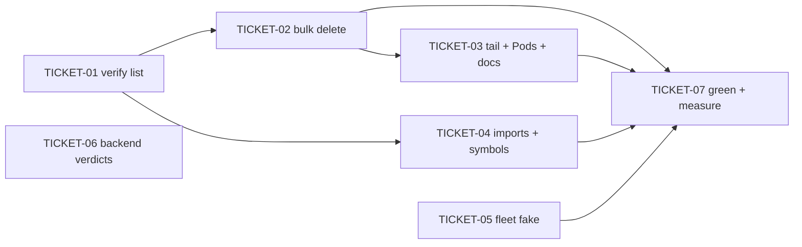

# Tasks — Dead-Code Cleanup (Change D)

> **STATUS:** `sliced` (2026-11-07)
> Waiver: small (waiver in briefing.md)

> Sliced from `.skillgrid/specs/2026-11-07-dead-code-cleanup/blueprint.md`.
> Light slice (fast-track `small` — the full pipeline still ran: blueprint +
> criticD authored 2026-11-07). Tickets map 1:1 to the blueprint's 7 tasks;
> the verified deletion list (TICKET-01) is the gate for every deletion.

## Epic Summary

Delete the CoreUI template demo material (58 unused files + Pods.tsx), the
79 unused imports, and the individually verified unused symbols — pure
deletions, zero behaviour change, proven by the suites green at every commit.
Record the dynamic-wiring verdict for the 23 backend files (no deletions) and
migrate the ~20 inline KubeDataTable test fakes onto one shared fake (moved
from change B, user decision 2026-11-07). Change D is the GATE for change B:
the template files are cleared before B's registry work (landing order
D → A → B → C).

## Delivery Strategy

| Field | Value |
|-------|-------|
| Estimated changed lines | ~13,500 (12,648 pure deletions + ~800 test-fake migration + ~150 import/symbol cleanup) |
| 400-line budget risk | High |
| Chained PRs recommended | Yes |
| Suggested split | PR 1 (verify + bulk) → PR 2 (tail) → PR 3 (imports + symbols) → PR 4 (fleet fake) → PR 5 (verdicts + measure) |
| Delivery strategy | ask-on-risk |
| Chain strategy | pending |

Decision needed before apply: Yes
Chained PRs recommended: Yes
Chain strategy: pending
400-line budget risk: High

### Suggested Work Units

| Unit | Goal | Likely PR | Focused test command | Runtime harness | Rollback boundary |
|------|------|-----------|----------------------|-----------------|-------------------|
| 1 | verification pass + bulk template deletion (components/forms/widgets/dashboard) | PR 1 | `cd frontend && corepack pnpm test && task fe-build && task fe-check` | jsdom unit + fe-build; no click-through (pure deletion, e2e held out for Unit 5) | the 39 deleted demo files + the verified list in the first commit body — revert = restore files |
| 2 | tail deletion (authentication/charts/icons/error-pages/docs helpers/store.js/Pods.tsx) | PR 2 | `cd frontend && corepack pnpm test && task fe-build && task fe-check` | jsdom unit + fe-build | the 19 deleted files — revert = restore |
| 3 | 79 unused imports + verified unused symbols | PR 3 | `cd frontend && corepack pnpm test && task fe-check && (cd backend && uv run pytest -m "not integration" && uv run ruff check . && uv run mypy app)` | jsdom unit + pytest + ruff + mypy | the import-cleanup lines + symbol deletions in the ~25 live files — revert restores (all were unused) |
| 4 | KubeDataTable test-fake fleet migration | PR 4 | `cd frontend && corepack pnpm test tests/views` | jsdom unit (tests/views) | the new shared fake + the ~20 re-pointed test files — test-only |
| 5 | 23-file backend verdicts + full floor + jscpd re-measure | PR 5 | `task e2e && npx jscpd --health --reporters ai .` | kind + Helm e2e for the held-out live-surface smoke | the .backlog verdict note + the measure commit — no source changes |

> The four plain-text guard lines above are the **contract** —
> `skillgrid:subagent-execution` matches them literally. If risk is High,
> `Chained PRs recommended` MUST be `Yes` and every work unit MUST name a
> focused test, a runtime harness (or `N/A` + reason), and a rollback
> boundary.

## Tickets

### TICKET-01 - verification pass - the deletion list

- **Tracker ID:** TASK-089
- **Scope:** re-generate the jscpd findings (`npx jscpd --dead-code --reporters json .`); verify each candidate file is import-free by grep on the import specifier/module path (not the bare basename — the collision-magnet: `DataTables` ⊃ `Tables`, CoreUI `C*` names, `Cluster/Dashboard` vs the template `Dashboard`, live `store/` zustand hits vs `store.js`); verify the unused-symbol candidates; record the verified list (no own commit — the list lands in TICKET-02's first commit body).
- **Acceptance:** every file in the deletion list carries a recorded zero-hit grep (pass-with-note or recorded exception annotated; a hit from a live file is an exclusion); the wsgi `_rq_worker_main`/`_build_worker_app` pair is recorded live-dynamic (the spawn string at `wsgi.py:179`), not as an exception; the verified list is on hand for TICKET-02.
- **SATISFIES:** deletion-list-verified
- **Files:** none modified (the list is recorded in TICKET-02's first commit body)
- **Size:** ~0 (S)
- **Blocks:** TICKET-02, TICKET-04
- **Blocked by:** none
- **Fails-when:** a file with a live-file import reference stays on the deletion list without a recorded exception, or the wsgi pair is treated as an exception instead of live-dynamic

### TICKET-02 - delete the template demo bulk (components/forms/widgets/dashboard)

- **Tracker ID:** TASK-090
- **Scope:** delete the verified `views/components/**`, `views/forms/**`, `views/widgets/**`, `views/dashboard/**` files (the files that passed TICKET-01); the verified list goes into this ticket's first commit body; commit `chore: delete CoreUI template demo files (components/forms/widgets/dashboard)`.
- **Acceptance:** `git status` matches the verified list exactly; no import specifier for a deleted file remains in `frontend/src`, `frontend/tests`, or `frontend/e2e`; `corepack pnpm test && task fe-build && task fe-check` green at this commit.
- **SATISFIES:** template-bulk-deleted
- **Files:** the 39 verified demo files (deleted)
- **Size:** ~8,500 deletions (L)
- **Blocks:** TICKET-03, TICKET-07
- **Blocked by:** TICKET-01
- **Precondition:** TICKET-01 complete — every file in the deletion list has a recorded zero-hit grep result (pass-with-notes / exceptions annotated)
- **Fails-when:** `git status` differs from the verified list, or `pnpm test` / `task fe-build` / `task fe-check` exits non-zero

### TICKET-03 - delete remaining template files, Pods.tsx, docs helpers

- **Tracker ID:** TASK-091
- **Scope:** delete the verified `views/authentication/**`, `views/charts/Charts.jsx`, `views/icons/**`, `views/error-pages/**`, `components/{AppContent,DocsComponents,DocsExample,DocsIcons,DocsLink}.jsx` (re-verified AFTER TICKET-02 — the 37 demo files that imported them from the `src/components` barrel are gone), `store.js`, `views/Cluster/Pods.tsx` (re-checked against the route table: `App.tsx` lazy imports + `stubRoutes` — it sits in a live view directory).
- **Acceptance:** no template demo page remains in `frontend/src/views`; no import specifier for a deleted file remains; `corepack pnpm test && task fe-build && task fe-check` green at this commit.
- **SATISFIES:** template-tail-deleted
- **Files:** the 19 verified files (deleted)
- **Size:** ~4,200 deletions (L)
- **Blocks:** TICKET-07
- **Blocked by:** TICKET-02
- **Precondition:** TICKET-02 committed — the 37 demo files importing the docs helpers from the `src/components` barrel are gone
- **Fails-when:** `pnpm test` / `task fe-build` / `task fe-check` exits non-zero, or a template demo file remains under `frontend/src/views`

### TICKET-04 - unused imports + verified unused symbols

- **Tracker ID:** TASK-092
- **Scope:** hand-delete the 79 unused-import findings from the TICKET-01 re-generated report (frontend — `pnpm lint --fix` is formatting-only here: the eslint config has no unused-imports rule and matches no `.ts/.tsx` file); `uv run ruff check --fix --select F401` + manual diff review (backend — the 4 backend files + `dev/sso/server.py` + `scripts/prometheus-push-e2e.py` + the migration; drop the `.git/lost-found` finding, not source); delete the verified unused symbols (`gateway_convert` leftovers `PROVIDERS`/`_REGEX_CHARS`/`_tls_secret_by_host`, the dead `KIND`/`LIST_ROUTE` constants in six data views, `NodeData.tsx` `PROBE_CONDITIONS`, `ServiceAccountData.tsx` `SecretRef` + its naming comment, unused `lib/types.ts`/`lib/groupTypes.ts` types, the migration's `_has_unique` + orphaned comment, `scripts/prometheus-push.py` `_METRIC_RE`) — the wsgi pair STAYS (live-dynamic).
- **Acceptance:** a re-generated jscpd report lists no unused-import finding; every verified symbol is gone; the test-only exports (`resetRefreshForTests`, `setLoginRedirectForTests`, `getRegisteredNavigate`) remain; the diff is deletions + import-cleanup lines only; `corepack pnpm test && task fe-build && task fe-check && uv run pytest -m "not integration" && uv run ruff check . && uv run mypy app` green.
- **SATISFIES:** unused-code-removed
- **Files:** ~15 files (import-cleanup lines), ~10 files (verified symbols)
- **Size:** ~250 (S/M)
- **Blocks:** TICKET-07
- **Blocked by:** TICKET-01
- **Fails-when:** any of the six verify commands exits non-zero, or the re-generated report still lists a removed import, or a test-only export is deleted

### TICKET-05 - KubeDataTable test-fake fleet migration

- **Tracker ID:** TASK-093
- **Scope:** extract the faithful init-time-capture fake (the DataTables init-time prop capture the PV/PVC usage-join tests depend on) from `pvs.test.tsx` into `frontend/tests/components/kube-data-table.test-utils.tsx`; re-point every inline `KubeDataTable` fake in `frontend/tests/views` (`grep -rln 'KubeDataTable' frontend/tests/views` is the authoritative list — the ~20 tests, three variants: simple, slot-renderer, faithful; where the variants conflict the faithful variant wins) at the shared fake, each test keeping its own canned data; a behaviour change is a stop-and-report, not a silent adaptation.
- **Acceptance:** no inline `KubeDataTable` fake remains in `frontend/tests/views` (all tests import the shared fake); test expectations unedited; `corepack pnpm test && task fe-build` green.
- **SATISFIES:** test-fake-fleet-migrated
- **Files:** `frontend/tests/components/kube-data-table.test-utils.tsx` (new), the ~20 re-pointed test files
- **Size:** ~700 (M)
- **Blocks:** TICKET-07
- **Blocked by:** none
- **Reversibility:** reversible
- **Fails-when:** `pnpm test` exits non-zero, a test expectation is edited, or an inline fake remains in `frontend/tests/views`

### TICKET-06 - backend 23 files - dynamic-wiring verdicts

- **Tracker ID:** TASK-094
- **Scope:** check each of the 23 backend files for dynamic wiring — grep scope `backend/` (the wsgi scheduler `INTERVALS` + enqueue loop at `wsgi.py:194` + the spawn string at `wsgi.py:179`; `tests/test_file_map.py`'s `EXPECTED` string-pins all 23 verbatim; the sockets blueprint registration — `SocketIO(` is instantiated nowhere, the two sockets files are docstring-only stubs; `app/models/__init__.py` deliberately keeps the 3 stub models UNIMPORTED — a design fact to record; the `:8443` aggregated mock mTLS app factory; services called by name or string from tasks/api); record the per-file verdict in a `.backlog` note — live-dynamic (`health.py`, `cluster_sync.py` — the only two that import live code), stub-by-design (the rest), string-pinned (all 23) — no deletions in this change.
- **Acceptance:** the backlog note carries a verdict for all 23 files with the `test_file_map.py` string-pin recorded; any proposed-deletion flag names the `test_file_map.py` + `ARCHITECTURE.md` section-2 updates it implies; no source file modified.
- **SATISFIES:** backend-files-verified
- **Files:** none (the `.backlog` note via the backlog CLI)
- **Size:** ~0 (S)
- **Blocks:** none
- **Blocked by:** none
- **Fails-when:** the note lacks a verdict for any of the 23 files, or a backend file is deleted

### TICKET-07 - green + measure

- **Tracker ID:** TASK-095
- **Scope:** the full verification floor (`corepack pnpm test`, `task fe-build`, `task fe-check`, `task e2e`, `uv run pytest -m "not integration"`, `uv run ruff check .`, `uv run mypy app`); `npx jscpd --health --reporters ai .` re-measure; record the new dead-code % + overall health vs the 2026-11-07 baseline (dead-code 22 / 16.6%, 187 findings) in the commit body.
- **Acceptance:** every floor command green including `task e2e` (the held-out live-surface check); the re-run shows the 58 deleted files + `Pods.tsx` + the 79 unused imports gone from the findings; the dead-code % drops from 16.6% toward ~1%; no clone pairs in `views/components|forms|widgets`; the numbers are in the commit body.
- **SATISFIES:** dead-code-measured
- **Files:** none (the measure commit body)
- **Size:** ~0 (S)
- **Blocks:** none
- **Blocked by:** TICKET-02, TICKET-03, TICKET-04, TICKET-05
- **Fails-when:** any floor command exits non-zero, or the re-measured dead-code % is not below the 16.6% baseline

## Dependency Graph

## Execution Order

- **Wave 1 (parallel):** TICKET-01, TICKET-05, TICKET-06 (no blockers — disjoint surfaces: the grep pass, `frontend/tests/views` + the new test file, and a `.backlog` note with zero source changes)
- **Wave 2 (parallel):** TICKET-02, TICKET-04 (both after TICKET-01; disjoint files — the deletion set vs the import-cleanup lines in live files)
- **Wave 3:** TICKET-03 (after TICKET-02 — the docs helpers are re-verified only after the bulk lands)
- **Wave 4:** TICKET-07 (after TICKET-02 + TICKET-03 + TICKET-04 + TICKET-05 — the measure must run on the final tree)

> **Acceptance-first (BDD is always on):** a ticket's failing acceptance
> scenario (its `SATISFIES` scenario) is written and confirmed RED *before*
> the implementation that makes it green. For this deletion change the RED
> state is the probe itself (the file still exists / the import is still
> listed / the fake is still inline) and the GREEN state is the post-change
> re-run — the scenario names in `acceptance.feature` are the oracle for
> both.

## Slicing Notes

- **D is the GATE for change B** (template files cleared before B's registry
  work) — cross-change landing order D → A → B → C. This is a landing-order
  note only, NOT encoded as ticket blockers here (A/B/C are their own
  changes).
- **1:1 with the blueprint's 7 tasks** (light slice, fast-track `small`): no
  re-slicing — the blueprint is post-critic (criticD SOUND-WITH-FIXES, all
  findings folded in) and its task boundaries ARE the vertical slices (each
  batch = verify → delete → green → commit).
- **TICKET-01 has no own commit** per the blueprint: the verified list lands
  in the body of TICKET-02's first deletion commit (the Must-Have artifact
  wording). TICKET-02 therefore carries a `Precondition:` on TICKET-01's
  output.
- **TICKET-05 is the sole test-file exception** to the pure-deletion
  constraint (moved from change B, user decision 2026-11-07) — flagged
  `Reversibility: reversible` (a test-fake migration, still deletions-adjacent:
  the inline fakes are removed, one shared fake added).
- **TICKET-06 executes in Wave 1** (zero source changes, no file deps) but is
  delivered in PR 5 with the close-out gate (TICKET-07) — it is a paper
  artifact (a `.backlog` note + its commit) with no source conflict on either
  chain strategy.
- **No one-way-door decisions** (blueprint: pure deletions, no contract
  touched) — the deletion tickets are git-revertable per batch (the blueprint
  mandates one conventional commit per batch) and carry no `one-way` flag.
- **Count caveat:** the per-directory counts (39 bulk + 19 tail) are
  indicative — the authoritative deletion set is the 58 findings from the
  TICKET-01 re-run (exceptions recorded); a file that fails verification is
  pulled from the list, not force-deleted.
