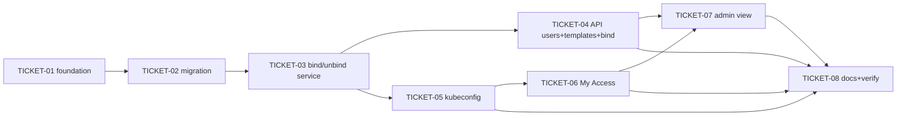

# Tasks — User Management (role templates, bindings, self-service kubeconfig)

> **STATUS:** `sliced` (2026-10-19)

> Sliced from `.skillgrid/specs/2026-10-19-user-management/blueprint.md`.
> Vertical tracer-bullet tickets, dependency-ordered, sized for one fresh agent context window.
> `SATISFIES` scenario names refer to `.skillgrid/specs/2026-10-19-user-management/acceptance.feature`.

## Epic Summary

Implement the ADR-0013 permission-management core end-to-end: admin user
management, RBAC role-template CRUD, idempotent bind/unbind that writes
Role/RoleBinding into the target cluster, and a self-service multi-cluster
kubeconfig that references the `kubedash` credential plugin (no embedded
token). Backend first (foundation → migration → bind → API → kubeconfig),
then the two frontend surfaces (My Access, admin view).

## Delivery Strategy

| Field | Value |
|-------|-------|
| Estimated changed lines | ~1800–2600 (backend ~1100, frontend ~700, migration + tests ~500) |
| 400-line budget risk | High |
| Chained PRs recommended | Yes |
| Suggested split | Unit 1 (T-01+T-02 foundation+migration) → Unit 2 (T-03+T-04 bind+API) → Unit 3 (T-05 kubeconfig) → Unit 4 (T-06+T-07 frontend) → Unit 5 (T-08 docs/verify) |
| Delivery strategy | feature-branch-chain (user-confirmed 2026-10-19) |
| Chain strategy | chained commits on the current work branch (`rebase`) — no merge to `main` |

Decision needed before apply: No
Chained PRs recommended: Yes
Chain strategy: feature-branch-chain
400-line budget risk: High

> **User decision (2026-10-19):** chain on the **current branch** — the work
> commits directly onto `rebase` (the repo's work branch / rollback unit) as
> one conventional commit per ticket, no separate feature branches, no merge
> to `main`. `subagent-execution` drives the tickets in wave order; each wave
> commits with a `[skillgrid-context]` block.

### Suggested Work Units

| Unit | Goal | Likely PR | Focused test command | Runtime harness | Rollback boundary |
|------|------|-----------|----------------------|-----------------|-------------------|
| 1 | Foundation + one-way-door migration (errors, config, models, seed) | Unit 1 | `cd backend && uv run pytest -m "not integration" tests/services/test_permission.py tests/api/test_admin_users.py` | Testcontainers Postgres; `flask db upgrade` on a fresh + dev DB | The single Alembic revision + the un-stubbed model files — revertable as a unit |
| 2 | Bind/unbind service + admin/templates/bind API | Unit 2 | `cd backend && uv run pytest -m "not integration" tests/api/test_permissions.py tests/api/test_admin_users.py` | Testcontainers Postgres + mocked K8sClient (unit); kind (integration) | `services/permission.py` + the API route bodies — revertable without touching PR 1 |
| 3 | Kubeconfig render + download endpoint | Unit 3 | `cd backend && uv run pytest -m "not integration" tests/api/test_kubeconfig.py tests/services/test_kubeconfig_render.py` | kind cluster; `kubectl config view --kubeconfig <generated>` | `services/kubeconfig_render.py` + `api/kubeconfig.py` — self-contained |
| 4 | Frontend My Access + admin permissions view | Unit 4 | `task fe-build && task fe-check && cd frontend && corepack pnpm test -- permissions` | MSW-mocked Vitest (no live backend); Playwright e2e (kind+Helm) | `frontend/src/views/Permissions/` + `AdminPermissions/` + nav/routes — removable |
| 5 | Docs, OpenAPI baseline, full-suite verification | Unit 5 | full matrix (backend unit+integration, `task fe-build`, `task fe-check`, `helm lint`) | full dev stack + kind | docs + `apidocs_paths_baseline.json` — no behavior |

> The four plain-text guard lines above are the **contract** — `skillgrid:subagent-execution` matches them literally.

## Tickets

> **Tracker (Backlog.md):** this change is published as two component-split
> tasks — **TASK-023** (backend, TICKET-01..05 + 08-backend) and **TASK-024**
> (frontend, TICKET-06..07 + 08-frontend, depends on TASK-023). TICKET-08
> (docs/full-verify) spans both and is tracked on each.

### TICKET-01 — Foundation: error codes, plugin-server setting, un-stub models

- **Tracker ID:** TASK-023

- **Scope:** Add the 2 new stable error codes, the `KUBEDASH_PLUGIN_SERVER` setting, un-stub `RBACTemplate` + `AuditLog` (full columns), and extend `ClusterBinding` (namespace/template/created_at + unique constraint + template-derived role).
- **Acceptance:** `errors.CODES` length is 14 with the two new classes; `config` exposes `plugin_server` (default None); `RBACTemplate` has name/description/scope/rules(JSONB)/created_by/created_at/builtin and is on `db.metadata`; `AuditLog` is on `db.metadata`; `ClusterBinding` has nullable `namespace`, `template`, `created_at`, a unique constraint on (user_id, cluster_id, namespace, template), and a template-derived `role` defaulting to viewer; `uv run pytest -m "not integration"` green, `mypy --strict` clean.
- **SATISFIES:** builtin-templates-are-seeded-and-protected; malformed-template-rule-is-rejected; admin-lists-and-patches-a-user
- **Files:** `backend/app/core/errors.py`, `backend/app/core/config.py`, `backend/app/models/rbac_template.py`, `backend/app/models/audit.py`, `backend/app/models/binding.py`, `backend/app/models/__init__.py`, `backend/tests/models/test_user_management_models.py` (new)
- **Size:** ~450 (M)
- **Blocks:** TICKET-02
- **Blocked by:** none

### TICKET-02 — One-way-door migration: seed templates, reconcile audit, extend bindings

- **Tracker ID:** TASK-023
- **Scope:** Alembic revision (down `6feadb091ff4`): create `rbac_templates` + seed the 4 built-ins (rules per ARCHITECTURE.md §5B); reconcile `audit_log` (additive `add_column` guarded by column-exists); extend `cluster_bindings` (+namespace nullable, +template nullable, +created_at server_default, backfill role) + unique constraint. Idempotent enough for a fresh DB and a populated dev DB.
- **Acceptance:** `flask db upgrade` on a fresh Postgres creates `rbac_templates` with exactly 4 seeded rows (builtin=True) and extends `cluster_bindings`; on a dev DB with data it applies without dropping rows; `flask db downgrade -1` reverses cleanly; a test asserts the 4 seeded built-ins with the correct rule sets.
- **SATISFIES:** builtin-templates-are-seeded-and-protected
- **Files:** `backend/migrations/versions/<rev>_user_management_adr_0013.py`, `backend/tests/migrations/test_user_management_revision.py` (new)
- **Size:** ~500 (M)
- **Blocks:** TICKET-03
- **Blocked by:** TICKET-01
- **Precondition:** `flask db current` succeeds against a reachable Postgres (Testcontainers or dev stack) and the head is `6feadb091ff4`
- **Reversibility:** one-way
- **Fails-when:** `flask db upgrade` exits non-zero, OR the seeded `rbac_templates` row count != 4, OR `flask db downgrade -1` exits non-zero

### TICKET-03 — k8s_client RBAC apply + permission service (bind/unbind) [TRACER]

- **Tracker ID:** TASK-023
- **Scope:** Add idempotent, label-aware `apply_role`/`apply_role_binding`/`apply_cluster_role`/`apply_cluster_role_binding` + their `delete_*` to `K8sClient`/`K8sClientPool`; implement `services/permission.py` `bind` (resolve→scope guard→apply→upsert binding, no-op+no re-audit if exists, audit, 502-without-row on cluster error) and `unbind` (find row→delete RoleBinding→role GC→delete row→audit); add `require_admin()` and reject `status=="disabled"` in `_auth_check`/`_load_user_for_claims`.
- **Acceptance:** unit (mock K8sClient): re-bind is a no-op (no 2nd audit row), role GC deletes the Role only on the last referrer, scope mismatch → 422, unknown triple → 404, unreachable cluster → 502 with no binding row, disabled user → 401; integration (kind-gated): a real bind creates Role+RoleBinding with correct rules + `kubedash.io/*` labels, re-bind no-op, unbind + GC verified.
- **SATISFIES:** admin-binds-a-template-and-it-applies-in-the-cluster; rebinding-the-same-binding-is-a-no-op; binding-with-a-mismatched-scope-is-rejected; unbinding-the-last-user-deletes-the-cluster-role; unbinding-a-missing-binding-is-a-404; binding-against-an-unreachable-cluster-records-nothing; disabled-user-is-rejected
- **Files:** `backend/app/services/k8s_client.py`, `backend/app/services/permission.py`, `backend/app/core/security.py`, `backend/tests/services/test_permission.py` (new), `backend/tests/integration/test_bind_kind.py` (new, kind-gated)
- **Size:** ~900 (M/L)
- **Blocks:** TICKET-04, TICKET-05
- **Blocked by:** TICKET-02
- **Fails-when:** `uv run pytest -m "not integration" tests/services/test_permission.py` exits non-zero, OR (where kind is present) the integration bind test does not find the expected RoleBinding labels

### TICKET-04 — API: admin users + templates CRUD + bind + my-access

- **Tracker ID:** TASK-023
- **Scope:** `api/admin.py` `GET /admin/users` (+cluster count) and `PATCH /admin/users/<id>` (role/status, audit, bootstrap-admin immutable 409); `api/permissions.py` templates CRUD (list/create/get/update/delete; built-in → 409 `BUILTIN_TEMPLATE_PROTECTED`; referenced-custom → 409 naming bindings), `POST/DELETE /admin/permissions/bind`, `GET /permissions/my-access` (caller's bindings, `[]` when none); `schemas/permissions.py`; replace the corresponding 501 stubs + update `test_stubs.py` and `apidocs_paths_baseline.json`.
- **Acceptance:** API tests (Testcontainers Postgres, mocked K8sClient): non-admin → 403 RBAC_DENIED; list/patch/audit correct; patching bootstrap admin → 409; template CRUD round-trips; built-in delete → 409 `BUILTIN_TEMPLATE_PROTECTED`; referenced-custom delete → 409 naming the binding; malformed rule → 422; bind 200/idempotent/422/404; my-access isolation (a user never sees another's); `uv run pytest -m "not integration"` green.
- **SATISFIES:** admin-lists-and-patches-a-user; bootstrap-admin-cannot-be-demotion-or-disabled; non-admin-cannot-reach-admin-users; admin-creates-and-reads-a-custom-template; malformed-template-rule-is-rejected; template-in-use-cannot-be-deleted; user-lists-their-own-bindings; user-with-no-bindings-sees-an-empty-list; a-user-never-sees-another-users-bindings
- **Files:** `backend/app/api/admin.py`, `backend/app/api/permissions.py`, `backend/app/schemas/permissions.py` (new), `backend/tests/api/test_admin_users.py` (new), `backend/tests/api/test_permissions.py` (new), `backend/tests/api/test_stubs.py`, `backend/tests/api/apidocs_paths_baseline.json`
- **Size:** ~700 (M)
- **Blocks:** TICKET-06, TICKET-07
- **Blocked by:** TICKET-03
- **Fails-when:** `uv run pytest -m "not integration" tests/api/test_admin_users.py tests/api/test_permissions.py` exits non-zero

### TICKET-05 — Kubeconfig render + download endpoint [TRACER]

- **Tracker ID:** TASK-023
- **Scope:** `services/kubeconfig_render.py` `render_kubeconfig(clusters, contexts, plugin_server)` (pure YAML: one context+cluster per bound cluster, `namespace` when namespaced, one shared `users[]` exec entry with `--server`, base64 CA); `services/permission.py` `generate_kubeconfig` (collect bindings, group by cluster, decrypt registry kubeconfig for server + CA — support `certificate-authority` file-form — `NO_BINDINGS` 404 when none, 500 when `plugin_server` unset); `api/kubeconfig.py` `GET /kubeconfig` returns the YAML as an `application/yaml` attachment.
- **Acceptance:** unit: single-cluster YAML (1 context/cluster/user, exec entry, base64 CA, namespace set), multi-cluster (N contexts, 1 shared user), no-binding → 404 `NO_BINDINGS`, unset plugin_server → 500, and the YAML contains **no** `token`/`tokenFile`/`oidc-*` keys; integration (kind): `kubectl config view --kubeconfig <generated>` parses and the exec `--server` matches `KUBEDASH_PLUGIN_SERVER`.
- **SATISFIES:** user-downloads-a-multi-cluster-kubeconfig; user-bound-to-one-cluster-gets-a-single-context-kubeconfig; user-with-no-bindings-gets-a-404; the-kubeconfig-never-embeds-a-token
- **Files:** `backend/app/services/kubeconfig_render.py` (new), `backend/app/services/permission.py`, `backend/app/api/kubeconfig.py`, `backend/tests/services/test_kubeconfig_render.py` (new), `backend/tests/api/test_kubeconfig.py` (new), `backend/tests/integration/test_kubeconfig_kind.py` (new, kind-gated)
- **Size:** ~550 (M)
- **Blocks:** TICKET-06
- **Blocked by:** TICKET-03
- **Fails-when:** `uv run pytest -m "not integration" tests/services/test_kubeconfig_render.py tests/api/test_kubeconfig.py` exits non-zero, OR the rendered YAML contains a `token:`/`tokenFile:`/`oidc-` key

### TICKET-06 — Frontend: My Access + kubeconfig download (all users)

- **Tracker ID:** TASK-024
- **Scope:** Add `datatables.net-react` + `datatables.net-bs5` and `components/KubeDataTable.tsx` (ADR-0023). `lib/api.ts` `downloadFile(path, filename)` blob helper (token + 401 refresh, error envelope on failure); `lib/types.ts` types; `views/Permissions/index.tsx` (CoreUI card + KubeDataTable columns Cluster, Namespace, Template, Created + Download kubeconfig; empty state does not mount the table); `_nav.tsx` + `routes.tsx` for `/permissions`; `tests/views/permissions.test.tsx` (MSW, KubeDataTable mocked).
- **Acceptance:** `task fe-build` (tsc+lint+build) green; `task fe-check` (no-CDN) green; MSW Vitest asserts columns and rows, download triggers `kubedash-kubeconfig.yaml`, empty state renders, 404/500 envelope shown as a message; no live backend needed.
- **SATISFIES:** user-downloads-a-kubeconfig-from-my-access; my-access-shows-an-empty-state-for-no-bindings
- **Files:** `frontend/package.json`, `frontend/src/components/KubeDataTable.tsx` (new), `frontend/src/lib/api.ts`, `frontend/src/lib/types.ts`, `frontend/src/views/Permissions/index.tsx` (new), `frontend/src/_nav.tsx`, `frontend/src/routes.tsx`, `frontend/tests/views/permissions.test.tsx` (new)
- **Size:** ~450 (M)
- **Blocks:** TICKET-07, TICKET-08
- **Blocked by:** TICKET-05
- **Fails-when:** `task fe-build` or `task fe-check` exits non-zero, OR `cd frontend && corepack pnpm test -- permissions` exits non-zero

### TICKET-07 — Frontend: 4.1 User List + privileges

- **Tracker ID:** TASK-024
- **Scope:** `views/AdminPermissions/index.tsx` is the 4.1 User List (card header "User List"; columns Username, Email, Permission, Type, Action; Privileges + Edit; Edit modal "Update Information"; no tab strip, no Add User, no Delete). `Privileges.tsx` at `/admin/permissions/users/:sub` lists bindings for the header's selected cluster and edits them with the 4.1 form (cluster template select; namespaced template + namespaces + all-namespaces; add row). `Templates.tsx` (`?tab=templates`) and `Audit.tsx` (`?tab=audit`) are separate pages, each a `KubeDataTable`. Admin route redirects non-admins. MSW tests mock `KubeDataTable`. Playwright e2e (kind+Helm) binds from the privilege form and downloads a kubeconfig from My Access.
- **Acceptance:** `task fe-build` + `task fe-check` green; MSW Vitest passes (User List columns, privilege submit, unbind, editor+preview, error paths render the envelope message with no console errors); non-admin redirected; Playwright e2e (kind+Helm) opens the User List, binds a template, and downloads a kubeconfig.
- **SATISFIES:** admin-binds-a-template-from-the-admin-view; the-admin-view-shows-api-errors-as-messages; a-non-admin-is-redirected-away-from-the-admin-view
- **Files:** `frontend/src/views/AdminPermissions/index.tsx`, `frontend/src/views/AdminPermissions/Privileges.tsx` (new), `frontend/src/views/AdminPermissions/Templates.tsx` (new), `frontend/src/views/AdminPermissions/Audit.tsx` (new), `frontend/src/_nav.tsx`, `frontend/src/routes.tsx`, `frontend/tests/views/admin_permissions.test.tsx`, `frontend/e2e/admin_permissions.spec.ts`
- **Size:** ~750 (M)
- **Blocks:** TICKET-08
- **Blocked by:** TICKET-04, TICKET-05, TICKET-06
- **Fails-when:** `task fe-build` or `task fe-check` exits non-zero, OR `cd frontend && corepack pnpm test -- admin_permissions` exits non-zero

### TICKET-08 — Docs, OpenAPI baseline, full-suite verification

- **Tracker ID:** TASK-023 + TASK-024 (spans both)
- **Scope:** `errors.py` count comment (10→14) + AGENTS.md config table (`KUBEDASH_PLUGIN_SERVER`) + ARCHITECTURE.md §5B service block (stub → implemented `PermissionService`) + ADR index note; confirm `apidocs_paths_baseline.json` reflects the real (non-501) routes and the stub-surface guard no longer lists them; run the full matrix (backend unit, backend integration where Docker present, frontend unit, `task fe-build`, `task fe-check`, `helm lint` + `helm template`).
- **Acceptance:** ARCHITECTURE.md §5B service block matches the code; AGENTS.md lists `KUBEDASH_PLUGIN_SERVER`; the error-code count comment is accurate (14); OpenAPI baseline matches the live routes; full matrix green (or Docker-blocked suites report `skipped`, not failed); `helm lint` + `helm template` clean.
- **SATISFIES:** (verification ticket — no new scenario; re-runs the full acceptance suite)
- **Files:** `.skillgrid/ARCHITECTURE.md`, `AGENTS.md`, `.skillgrid/ASSUMPTIONS.md`, `backend/tests/api/apidocs_paths_baseline.json`
- **Size:** ~250 (S)
- **Blocks:** none
- **Blocked by:** TICKET-04, TICKET-05, TICKET-06, TICKET-07
- **Fails-when:** any full-matrix command exits non-zero (excluding Docker-blocked suites reporting skipped)

## Dependency Graph

## Execution Order

- **Wave 1:** TICKET-01 (foundation)
- **Wave 2:** TICKET-02 (migration — one-way, human checkpoint before apply)
- **Wave 3:** TICKET-03 (bind/unbind service — tracer core)
- **Wave 4:** TICKET-04 (API), TICKET-05 (kubeconfig — tracer end) — parallel, both after T-03
- **Wave 5:** TICKET-06 (My Access) — after T-05
- **Wave 6:** TICKET-07 (admin view) — after T-04 + T-05 + T-06
- **Wave 7:** TICKET-08 (docs + full verification) — after all

> **Acceptance-first (BDD is always on):** each ticket's `SATISFIES` scenario in
> `acceptance.feature` is confirmed RED (failing) before the implementation that
> turns it green. The scenario/RED state is established in the ticket's test
> files (T-01 model tests, T-03 service tests, T-04/05 API tests, T-06/07 MSW
> tests) ahead of the route/view bodies.

## Slicing Notes

- **Tracer thread honored:** T-03 (bind) and T-05 (kubeconfig) are the two
  tracer checkpoints. If the RoleBinding idempotency (T-03) or the YAML shape
  the plugin accepts (T-05) is wrong, stop and re-examine before T-04/06/07.
- **Migration is its own one-way ticket (T-02):** the `cluster_bindings`
  schema change is one-way-door (ADR-0002/0013), so it carries
  `Precondition` + `Reversibility: one-way` + `Fails-when` and a human
  checkpoint before apply. It is isolated so the rollback unit is a single
  revertable revision.
- **`cluster_bindings.role` is kept, template-derived** (default viewer) so the
  existing cluster-visibility gate keeps working — flagged as an owed decision
  in the blueprint; if a template maps to a role outside {viewer, editor,
  admin}, an ADR-0013 addendum is recorded before T-02.
- **CA file-form vs data-form:** T-05 supports both (base64 the file content
  when `certificate-authority` path is present). Normalizing registration to
  `-data` is a cluster-registry (ADR-0002) change, out of scope here.
- **T-04 and T-05 are parallel** (both depend only on T-03) and independently
  reviewable; T-06 depends only on T-05, so the all-users surface can land
  before the admin view (T-07).
- **Two new stable error codes** (`BUILTIN_TEMPLATE_PROTECTED`, `NO_BINDINGS`)
  touch the frozen v1 contract (currently 12 → 14). Both are introduced in
  T-01 and the count comment is corrected in T-08 — no separate versioning task.
- **File-boundary assumption:** the admin gate is a `require_admin()` helper in
  `core/security.py` (T-03); `_authhook.py` is unchanged (path-scoped auth
  already covers `/api/v1/*`).
