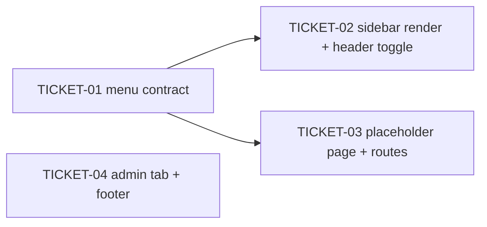

# Tasks — Sidebar: 4.1 look and menu structure (React/CoreUI)

> **STATUS:** `sliced` (2026-10-21)

> Sliced from `.skillgrid/specs/2026-10-21-sidebar-nav/blueprint.md`.
> Vertical tracer-bullet tickets, dependency-ordered, sized for one fresh agent context window.
> `SATISFIES` scenario names refer to `.skillgrid/specs/2026-10-21-sidebar-nav/acceptance.feature`.
> Each `SATISFIES` scenario has a Vitest test whose title is exactly the scenario name, so `skillgrid:qa` can trace it.

## Epic Summary

Replace the four-item sidebar with the 4.1 menu structure (Dashboard, Permissions, Interface, admin-only Settings), minus the Plugins group, with Cluster Details first under Permissions. Entries without a view open one shared placeholder page. The header menu button really toggles the sidebar, and the footer carries the 4.1 wording with no outbound links. Frontend only, React/CoreUI only — 4.1's Jinja templates are a visual reference, not an input (blueprint § Implementation Boundary).

## Delivery Strategy

| Field | Value |
|-------|-------|
| Estimated changed lines | ~600–750 (menu contract + tests ~300, sidebar/header ~150, routes + stub ~200, footer + admin tab ~80) |
| 400-line budget risk | Medium |
| Chained PRs recommended | No |
| Suggested split | Single PR: one conventional commit per ticket on `rebase` |
| Delivery strategy | auto-chain |
| Chain strategy | stacked-to-main |

Decision needed before apply: No
Chained PRs recommended: No
Chain strategy: stacked-to-main
400-line budget risk: Medium

> Per AGENTS.md § Conventions (Commits), work lands on `rebase` and is not merged into `main` by ship. "stacked-to-main" here means ticket commits land in order on the work branch; nothing is pushed without asking (AGENTS.md § Boundaries).

### Suggested Work Units

| Unit | Goal | Likely PR | Focused test command | Runtime harness | Rollback boundary |
|------|------|-----------|----------------------|-----------------|-------------------|
| 1 | Menu contract, rendered sidebar, header toggle, stubs, admin tab, footer | PR 1 | `pnpm --dir frontend exec vitest run && task fe-build && task fe-check` | Vitest + Testing Library + MSW (no live backend); optional visual check with `task fe-dev` | `frontend/src/_nav.tsx`, `views/Stub/`, `store/sidebar.ts`, and the sidebar/header/footer/App edits — revert the four ticket commits |

> The four plain-text guard lines above are the **contract** — `skillgrid:subagent-execution` matches them literally.

## Tickets

> **Tracker (Backlog.md):** milestone `m-1` "2026-10-21-sidebar-nav"; one frontend task per ticket. TASK-026 and TASK-027 depend on TASK-024. The CLI only accepts `--plan` for tasks created in an active status, so each task description points at its blueprint task instead.

### TICKET-01 — Menu contract: `navigation()` with Cluster Details under Permissions

- **Tracker ID:** TASK-024
- **Scope:** Replace the flat array in `_nav.tsx` with `navigation({ clusterId, isAdmin })` returning the briefing's § Menu rows, section titles, dividers, `Beta` badge, and paths; Settings only for admins; no Plugins or plugin-gated entries. Blueprint Task 1 (door check).
- **Acceptance:** `navigation({ clusterId: 7, isAdmin: true })` flattens to exactly the briefing's label order; Cluster Details is the first Permissions entry with `to === '/clusters/7'`; `clusterId: null` gives `to === '/clusters'`; `isAdmin: false` omits Settings and its four entries; Cluster Metrics and Kubernetes Cluster both point at `/clusters`; none of Plugins, Cert-Manager, LoadBalancers, Gateway API, Trivy Operator, Applications appear for either role.
- **SATISFIES:** menu-matches-4-1-without-plugins; cluster-details-follows-selection; cluster-details-without-selection-opens-cluster-list; plugin-entries-never-appear; cluster-metrics-and-kubernetes-cluster-share-cluster-list
- **Files:** `frontend/src/_nav.tsx`, `frontend/tests/nav.test.tsx` (new)
- **Size:** ~300 (S)
- **Blocks:** TICKET-02, TICKET-03
- **Blocked by:** none
- **Fails-when:** `pnpm --dir frontend exec vitest run tests/nav.test.tsx` exits non-zero, or any listed scenario title is missing from its output.

### TICKET-02 — Render the menu in the sidebar and share the header toggle

- **Tracker ID:** TASK-026
- **Scope:** `AppSidebar` feeds `navigation()` from the selected cluster and `me.role`; `AppSidebarNav` renders divider items; new `useSidebarStore` drives `CSidebar` visibility from the header menu button; the footer fold button keeps toggling `unfoldable` only. Blueprint Task 2.
- **Acceptance:** with "prod" (id 7) selected and an admin signed in, the rendered Permissions section starts with a Cluster Details link to `/clusters/7`, then My access; the Workload entry shows a `Beta` badge and Cluster Metrics shows none; a non-admin render has no Settings text; pressing the header button (`aria-label="Toggle sidebar"`) removes the sidebar's `show` class and pressing it again restores it; pressing the footer fold button does not remove `show`. The unused `sidebarShow` state in `AppHeader` is gone.
- **SATISFIES:** sidebar-shows-cluster-details-link; workload-entry-shows-beta-badge; settings-hidden-for-non-admin; header-toggler-hides-sidebar; header-toggler-restores-sidebar; folding-the-sidebar-does-not-hide-it
- **Files:** `frontend/src/store/sidebar.ts` (new), `frontend/src/components/AppSidebar.jsx`, `frontend/src/components/AppSidebarNav.jsx`, `frontend/src/components/AppHeader.jsx`, `frontend/tests/nav.test.tsx`
- **Size:** ~150 (S)
- **Blocks:** none
- **Blocked by:** TICKET-01
- **Fails-when:** `pnpm --dir frontend exec vitest run` exits non-zero (including the existing view tests), or `task fe-build` exits non-zero.

### TICKET-03 — Placeholder page and routes for every entry without a view

- **Tracker ID:** TASK-027
- **Scope:** Add `views/Stub` (heading = menu label, body `This view is not available yet.`) and register one route per stub row in `App.tsx` before the catch-all; `/settings/*` stubs sit behind `ProtectedRoute` + `AdminRoute`; existing view routes are untouched. Blueprint Task 3 (stub half).
- **Acceptance:** `/workload/pods` shows heading `Pods` and the stub sentence and does not redirect; each Examples row of `every-stub-entry-has-a-page` renders its own heading; `/settings/sso-config` renders `Auth Provider` for an admin and redirects a non-admin to `/`; `/permissions` still renders the My access view (not the stub); an unknown path still redirects to `/clusters`; every stub path in `App.tsx` equals a stub path returned by `navigation({ clusterId: 7, isAdmin: true })` (test compares the two lists).
- **SATISFIES:** stub-page-names-the-entry; every-stub-entry-has-a-page; settings-url-rejects-non-admin; existing-views-still-open; unknown-path-still-redirects-to-cluster-list
- **Files:** `frontend/src/views/Stub/index.tsx` (new), `frontend/src/App.tsx`, `frontend/tests/views/Stub.test.tsx` (new)
- **Size:** ~200 (S)
- **Blocks:** none
- **Blocked by:** TICKET-01
- **Fails-when:** `pnpm --dir frontend exec vitest run tests/views/Stub.test.tsx` exits non-zero, or the route-list-vs-`navigation()` comparison reports a missing or extra path.

### TICKET-04 — Admin tab from the menu link, and 4.1 footer text without links

- **Tracker ID:** TASK-025
- **Scope:** `AdminPermissionsView` picks its initial tab from `?tab=` (`users` / `templates` / `audit`, anything else → `users`) via `useSearchParams`; `AppFooter` shows the 4.1 wording as plain text with no anchors. Blueprint Task 3 (admin-tab and footer half).
- **Acceptance:** at `/admin/permissions?tab=audit` the `Audit` tab button has `aria-selected="true"` and `Audit log not available.` is shown (existing 501 MSW handler); `?tab=bogus` selects Users; a non-admin at `/admin/permissions?tab=audit` is redirected to `/` by `AdminRoute`; the footer shows `DevOpsTales - KubeDash Copyright © 2021-2026` and `Powered by CoreUI UI Components` with `querySelectorAll('a').length === 0`; `task fe-check` exits 0.
- **SATISFIES:** audit-tab-opens-from-menu; unknown-tab-falls-back-to-users; non-admin-cannot-open-audit-tab; footer-shows-4-1-labels; footer-has-no-outbound-link; bundle-passes-air-gap-check
- **Files:** `frontend/src/views/AdminPermissions/index.tsx`, `frontend/src/components/AppFooter.jsx`, `frontend/tests/views/admin_permissions.test.tsx`, `frontend/tests/components/AppFooter.test.tsx` (new)
- **Size:** ~80 (S)
- **Blocks:** none
- **Blocked by:** none
- **Fails-when:** `pnpm --dir frontend exec vitest run tests/views/admin_permissions.test.tsx tests/components/AppFooter.test.tsx` exits non-zero, or `task fe-check` exits non-zero.

## Dependency Graph

## Execution Order

- **Wave 1 (parallel):** TICKET-01 (door check), TICKET-04
- **Wave 2 (parallel):** TICKET-02, TICKET-03 — both after TICKET-01
- **Final check (after all):** `pnpm --dir frontend exec vitest run && task fe-build && task fe-check`, then `qlty fmt` and `qlty check --fix --level=low` per AGENTS.md § Quality gate.

> **Acceptance-first (BDD is always on):** each ticket's `SATISFIES` scenarios are written as failing Vitest tests (titled with the scenario name) and confirmed RED before the implementation that turns them green.

## Slicing Notes

- **Door check first:** TICKET-01 proves the `navigation()` shape renders through the existing `AppSidebarNav` contract. If the order or Plugins-absence assertions cannot pass without a new nav component, stop before TICKET-02/03 (blueprint § Hypothesis).
- **TICKET-01 is a data prefactor, not a full vertical slice.** It is kept separate on purpose: it is the door check and both later tickets consume its exact paths.
- **Blueprint Task 3 was split in two** (TICKET-03 placeholder routes, TICKET-04 admin tab + footer). The two halves share no code, so TICKET-04 runs in wave 1.
- **Test files differ from the blueprint** to allow parallel waves: TICKET-03 tests go in `frontend/tests/views/Stub.test.tsx`, TICKET-04 tests extend `frontend/tests/views/admin_permissions.test.tsx` and add `frontend/tests/components/AppFooter.test.tsx`. Only TICKET-01 and TICKET-02 share `frontend/tests/nav.test.tsx`, and they are in different waves.
- **Acceptance runner:** the repo has no `acceptance-tests/` cucumber project; as in the 2026-10-19 user-management change, scenarios are traced through test titles. `acceptance.feature` was syntax-checked with `@cucumber/gherkin` (22 scenarios, no duplicate names).
- **ADR-0022 is not edited** (IRON RULE). Cluster Details and My access are the only rows beyond its table, recorded in briefing.md § Menu and the blueprint decision note.
- **No new dependencies.** `zustand`, `@coreui/icons`, React Router, Vitest, and MSW are already in `frontend/package.json`.
