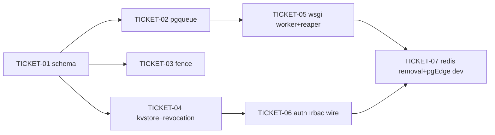

# Tasks — Postgres queue, session revocation, OIDC state, SAR cache, active-active Postgres

> **STATUS:** `sliced` (2026-10-27)

> Sliced from `.skillgrid/specs/2026-10-27-postgres-queue-revocation-active-active/blueprint.md`.
> Vertical tracer-bullet tickets, dependency-ordered, sized for one fresh agent context window.
> `SATISFIES` scenario names refer to `.skillgrid/specs/2026-10-27-postgres-queue-revocation-active-active/acceptance.feature`.

## Epic Summary

Replace all four Redis consumers (RQ broker, `jti` revocation, OIDC `state`, SAR verdict cache) with Postgres — a `tasks` queue on `FOR UPDATE SKIP LOCKED`, a `revoked_jtis` deny-list, and a generic `kv` TTL table — add a strict `fence` to the leader election, and make the dev stack a two-node pgEdge active-active cluster with no Redis. Tracer thread: TICKET-01 (schema) → TICKET-02 (pgqueue) → TICKET-05 (wsgi) is the first working end-to-end queue; the auth/fence/dev slices thicken around it.

## Delivery Strategy

| Field | Value |
|-------|-------|
| Estimated changed lines | ~1400–1900 |
| 400-line budget risk | High |
| Chained PRs recommended | Yes |
| Suggested split | PR 1 (schema+pgqueue+wsgi) → PR 2 (fence+auth+rbac) → PR 3 (redis removal+pgEdge dev) |
| Delivery strategy | ask-on-risk |
| Chain strategy | single-branch on `rebase` (user decision 2026-10-27: keep all 7 tickets on the `rebase` work branch — no PR chain; the branch is the deliverable + rollback unit) |

Decision needed before apply: No (user decided 2026-10-27)
Chained PRs recommended: No (single-branch on `rebase`; the 3-unit split above is the logical rollback boundary, not a PR chain)
Chain strategy: single-branch on `rebase`
400-line budget risk: High

### Suggested Work Units

| Unit | Goal | Likely PR | Focused test command | Runtime harness | Rollback boundary |
|------|------|-----------|----------------------|-----------------|-------------------|
| 1 | `tasks`/`revoked_jtis`/`kv` + `fence` schema; `pgqueue` claim/reaper/retry; `wsgi` worker+reaper (RQ gone) | PR 1 | `cd backend && uv run pytest tests/core/test_pgqueue.py tests/test_worker_gate.py -q` | Testcontainers Postgres; queue e2e is pure-DB (no Redis) | revert `pgqueue.py` + the `wsgi` worker section; RQ path can be re-pointed |
| 2 | `Leader.fence`; `kvstore`+`revocation`; wire `verify_jwt`/`new_state`/`consume_state`/`logout`/SAR cache to Postgres | PR 2 | `cd backend && uv run pytest tests/core/test_leader_fence.py tests/core/test_kvstore.py tests/services/test_revocation.py tests/core/test_security_revocation.py tests/services/test_rbac_cache.py -q` | Testcontainers Postgres; real JWT round-trip; no Redis | revert `leader.py` fence + the 3 call-site swaps; Redis consumers re-appear (unit still green) |
| 3 | Remove `flask-redis`/`redis_client`/`redis_url`; two-node pgEdge dev compose; Taskfile re-point | PR 3 | `cd backend && uv run pytest tests/test_no_redis_imports.py -q && task dev-up` (smoke) | two-node pgEdge compose (live); `task dev-up` smoke | revert the compose + dep removal; single-`postgres:16` compose re-appears |

> The four plain-text guard lines above are the **contract** — `skillgrid:subagent-execution` matches them literally. Risk is High → `Chained PRs recommended` is `Yes` and every work unit names a focused test, a runtime harness, and a rollback boundary.

## Tickets

### TICKET-01 — Migration: `tasks`, `revoked_jtis`, `kv`, `leader_lease.fence`

- **Tracker ID:** TASK-042
- **Scope:** one Alembic migration creating the three tables creating the three tables + the `fence` column; the three ORM models; export them from `app.models`. The tracer-thread foundation every later ticket reads.
- **Acceptance:** after `alembic upgrade head`, `tasks`/`revoked_jtis`/`kv` exist with the right columns/constraints (`tasks`: id/path/status/attempts/enqueued_at/locked_at/locked_by/available_at + plain index; `revoked_jtis`: jti PK + expires_at; `kv`: key PK + value + expires_at + index); `leader_lease.fence` is NOT NULL default 0. **No** partial index with `now()` in the predicate (findings #2).
- **SATISFIES:** `enqueue-then-claim-returns-the-task-path` (schema half — the `tasks` row is claimable once it exists)
- **Files:** `backend/migrations/versions/<new>_queue_revocation_kv_fence.py`, `backend/app/models/{task,revocation,kv}.py`, `backend/app/models/__init__.py`, `backend/tests/models/test_new_tables.py`
- **Size:** ~350 (S)
- **Blocks:** TICKET-02, TICKET-03, TICKET-04
- **Blocked by:** none
- **Reversibility:** one-way — STOP for explicit approval before running the migration (new tables + `fence` column; migration-gated).
- **Precondition:** `alembic heads` shows a single head `2eb286befb21` (no divergent branches to merge).
- **Fails-when:** `uv run pytest tests/models/test_new_tables.py -v` errors on a missing table/column, or the migration `down_revision` does not equal the current head.

### TICKET-02 — `pgqueue` module: `SKIP LOCKED` claim, time-based reaper, 3× backoff → dead-letter

- **Tracker ID:** TASK-043
- **Scope:** `app/core/pgqueue.py` — `enqueue`, `claim` (atomic `FOR UPDATE SKIP LOCKED`), `complete`, `fail` (re-queue with `LEAST(cap, base*5^attempts)` backoff, dead-letter at `attempts >= 3`), `reap` (re-queue stale `processing` rows), `backoff_seconds`. Pure SQLAlchemy `text()`; no Flask imports.
- **Acceptance:** enqueue→claim returns the path and sets the row `processing`/`locked_by`; 10 concurrent claimers on 50 rows → exactly 10 distinct claims, 0 double-claimed; a failing task retries 3× with the backoff curve then `status='failed'`; a `processing` row with `locked_at` older than the reaper interval is re-queued to `pending` by `reap`. Reaper interval constant (>2 min) > longest task runtime (findings #6).
- **SATISFIES:** `enqueue-then-claim-returns-the-task-path`, `concurrent-claimers-never-double-claim`, `failed-task-retries-with-backoff-then-dead-letters`, `crashed-claim-is-requeued-by-the-time-based-reaper`
- **Files:** `backend/app/core/pgqueue.py`, `backend/tests/core/test_pgqueue.py`
- **Size:** ~350 (S)
- **Blocks:** TICKET-05
- **Blocked by:** TICKET-01
- **Precondition:** TICKET-01 migration applied to the test DB (Testcontainers Postgres at head).

### TICKET-03 — `leader.py` strict fence (ADR-0031)

- **Tracker ID:** TASK-044
- **Scope:** add a monotonic `fence` to the election. Acquire (the lease upsert at `leader.py:118-127`) becomes `INSERT … fence=fence+1 … ON CONFLICT DO UPDATE … RETURNING fence`; the stale check (`leader.py:106-112`) stays as a fast path but the fence is the cross-node LWW (the advisory lock is session-local — not a cross-node mutex). `_heartbeat` conditions `WHERE id=1 AND replica_id=:rid AND fence=:f` and demotes on 0 rows. Expose `Leader.fence`.
- **Acceptance:** after A acquires (fence 1) and B acquires (fence 2), A's stale-fence heartbeat affects 0 rows and A demotes to non-leader; a fenced write (`WHERE fence=:my_fence`) from the stale leader is rejected (0 rows) while the current fence-holder's write commits (1 row).
- **SATISFIES:** `stale-leader-write-is-rejected-by-the-fence`
- **Files:** `backend/app/core/leader.py`, `backend/tests/core/test_leader_fence.py`
- **Size:** ~180 (S)
- **Blocks:** none
- **Blocked by:** TICKET-01
- **Precondition:** TICKET-01 `fence` column present in the test DB.

### TICKET-04 — `kvstore` + `revocation` (OIDC state, `jti` deny-list, SAR cache backend)

- **Tracker ID:** TASK-046
- **Scope:** `app/core/kvstore.py` — `kv_set`/`kv_get`/`kv_delete`/`kv_reap` (generic TTL kv; `kv_get` returns None if absent **or** expired; `kv_delete` one-shot). `app/services/revocation.py` — `revoke_jti`/`is_revoked`/`reap_expired` (pure; no Flask). Both bind the key/`jti` as a **parameter** — no function in the WHERE clause (findings #1).
- **Acceptance:** `kv_set`→`kv_get`→`kv_delete` round-trips; an expired key reads as absent; `kv_reap` deletes only expired rows; `revoke_jti`→`is_revoked` is True, a different jti is False; `reap_expired` deletes only passed jtis. The revocation lookup plans as a PK Index Only Scan.
- **SATISFIES:** `oidc-state-is-stored-and-consumed-once` (kv half — one-shot delete), `revoked-jti-is-rejected-on-the-verify-hook` (deny-list half — the PK lookup)
- **Files:** `backend/app/core/kvstore.py`, `backend/app/services/revocation.py`, `backend/tests/core/test_kvstore.py`, `backend/tests/services/test_revocation.py`
- **Size:** ~300 (S)
- **Blocks:** TICKET-06
- **Blocked by:** TICKET-01

### TICKET-05 — `wsgi.py`: `pgqueue` poll worker + leader-gated reaper (replace RQ)

- **Tracker ID:** TASK-045
- **Scope:** the tracer-thread end. Replace the RQ scheduler/worker child in `wsgi.py` with a poll loop: `_run_once` enqueues due tasks via `pgqueue.enqueue` only while `leader.is_leader()` (preserve `INTERVALS` + the role gate); `_worker_loop` `pgqueue.claim`s every 5 s, runs the task, `complete`/`fail`s; a leader-gated reaper sweeps `pgqueue.reap` + `revocation.reap_expired` + `kvstore.kv_reap`. Update `tests/test_worker_gate.py`: keep the `_FakeLeader` + role-gate tests, point the scheduler's `_Queue` seam at a `pgqueue`-shaped fake (`enqueue(path, engine)`), and re-point the `integration` job-runs test to the `pgqueue` claim path (no Redis).
- **Acceptance:** the scheduler enqueues due tasks only when leading (the existing `test_schedule_if_leader_*` shape, now against a `pgqueue`-shaped seam); the leader role still spawns the `kubedash-worker` daemon thread (no RQ child); a job enqueued while leading executes via the `pgqueue` claim (integration).
- **SATISFIES:** `crashed-claim-is-requeued-by-the-time-based-reaper` (wiring half — the reaper runs leader-gated)
- **Files:** `backend/wsgi.py`, `backend/tests/test_worker_gate.py`
- **Size:** ~450 (S/M)
- **Blocks:** TICKET-07
- **Blocked by:** TICKET-02
- **Precondition:** TICKET-02 `pgqueue` importable; `tests/test_worker_gate.py` currently green on `rebase`.
- **Fails-when:** `uv run pytest tests/test_worker_gate.py -v` errors, or `wsgi` still imports `rq`.

### TICKET-06 — Wire auth + RBAC to Postgres (`verify_jwt`, OIDC state, logout, SAR cache)

- **Tracker ID:** TASK-047
- **Scope:** swap the four Redis call sites. `security.py` — `verify_jwt` → `revocation.is_revoked(db.engine, jti)`; `new_state`/`consume_state` → `kvstore` (one-shot). `api/auth.py` — `logout` → `revocation.revoke_jti(db.engine, _current_jti(), ACCESS_TTL_SECONDS)` (keep refresh-token revocation; add the `_current_jti()` helper in `security.py`). `rbac.py` — `_cache_get`/`_cache_set` → `kvstore` (drop the `redis_client` import + bytes-decode branch).
- **Acceptance:** a logged-out token's jti, replayed → 401 `token revoked` before expiry; `verify_jwt` raises on a `revoked_jtis` hit; `consume_state` is one-shot (second consume → `StateMismatchError`); `rbac.can` on a cached key serves from `kv` and never re-asks the cluster (a throwing `pool.get` is never called on a hit).
- **SATISFIES:** `logout-revokes-the-access-token-jti`, `revoked-jti-is-rejected-on-the-verify-hook`, `oidc-state-is-stored-and-consumed-once`, `sar-cache-hit-never-reasks-the-cluster`
- **Files:** `backend/app/core/security.py`, `backend/app/api/auth.py`, `backend/app/services/rbac.py`, `backend/tests/core/test_security_revocation.py`, `backend/tests/services/test_rbac_cache.py`
- **Size:** ~400 (S)
- **Blocks:** TICKET-07
- **Blocked by:** TICKET-04

### TICKET-07 — Remove Redis from the stack + two-node pgEdge dev compose

- **Tracker ID:** TASK-048
- **Scope:** the contract step. Remove `FlaskRedis`/`redis_client` from `extensions.py`; the import + `init_app` + `/readyz` redis ping from `__init__.py`; `redis_url` from `config.py` + the field/`_resolve_redis` from `ini_config.py`; `flask-redis` (+ `rq` if unused) from `pyproject.toml`. Add `dev/docker-compose.pgedge.yml` + `dev/pgedge/db.json` (two `pgedge/pgedge:pg17-latest` nodes, `autoddl`, the `pgedge` internal_admin user, hostnames matching the compose service names — findings #5); replace `postgres`+`redis` in `dev/docker-compose.yml` with the pgEdge include and drop `redisdata`; re-point `Taskfile.yaml` `dev-up`/`dev-ps`/`db-shell` at n1.
- **Acceptance:** no module in `backend/app` references `redis_client` or `flask_redis`; `flask-redis` is not in `pyproject.toml`; `task dev-up` brings up two pgEdge nodes (both in `spock.node`) with **no** redis container; the backend passes its health check against n1; a migration applied on n1 is present on n2 (`autoddl`).
- **SATISFIES:** `no-module-imports-redis-client`, `dev-up-brings-two-pgedge-nodes-with-no-redis`, `migration-run-on-one-node-propagates-to-the-other`
- **Files:** `backend/app/extensions.py`, `backend/app/__init__.py`, `backend/app/core/config.py`, `backend/app/core/ini_config.py`, `backend/pyproject.toml`, `dev/docker-compose.yml`, `dev/docker-compose.pgedge.yml`, `dev/pgedge/db.json`, `Taskfile.yaml`, `backend/tests/test_no_redis_imports.py`
- **Size:** ~450 (S/M)
- **Blocks:** none
- **Blocked by:** TICKET-05, TICKET-06
- **Reversibility:** one-way — STOP for explicit approval before removing `flask-redis`/`KUBEDASH_REDIS_URL` and switching the dev default to pgEdge (every Redis consumer must be gone from TICKET-05/06 or the app fails to boot).
- **Precondition:** `grep -rn redis_client backend/app` returns 0 hits (TICKET-05 + TICKET-06 landed); `pgedge/pgedge:pg17-latest` is pullable.
- **Fails-when:** `uv run pytest tests/test_no_redis_imports.py -q` finds a `redis_client` reference, or `task dev-up` shows a `redis` container / fewer than two `spock.node` rows.

## Dependency Graph

## Execution Order

- **Wave 1 (serial — single head):** TICKET-01 (migration + models; the schema everything reads)
- **Wave 2 (parallel — three independent modules off the schema):** TICKET-02 (pgqueue), TICKET-03 (fence), TICKET-04 (kvstore + revocation)
- **Wave 3 (parallel — wire each module into a consumer):** TICKET-05 (wsgi, needs pgqueue), TICKET-06 (auth+rbac, needs kvstore+revocation)
- **Wave 4 (contract step):** TICKET-07 (remove Redis + pgEdge dev; needs 05 + 06)

> **Acceptance-first (BDD is always on):** a ticket's failing acceptance scenario (its `SATISFIES` scenario) is written and confirmed RED *before* the implementation that makes it green. The tracer thread is TICKET-01 → 02 → 05 (schema → pgqueue → wsgi); the auth path is TICKET-01 → 04 → 06; the fence is TICKET-01 → 03; TICKET-07 is the contract step that removes the now-unused Redis.

## Slicing Notes

- **Why TICKET-01 is Wave 1 (serial) despite being "horizontal":** all six later tickets read the three new tables + the `fence` column from the *same single migration head* (`2eb286befb21`). A migration is a serial schema boundary — there is no seam to parallelize it, and every dependent ticket is blocked by it being applied. This is the prefactor exception the slicing rules allow.
- **Why the fence (TICKET-03) is its own ticket, not folded into wsgi (TICKET-05):** the fence is the ADR-0031 cross-node LWW — a distinct trust-boundary change with its own RED scenario (`stale-leader-write-is-rejected-by-the-fence`). Keeping it separate keeps the wsgi ticket's diff focused on the worker/reaper swap. The fence is *not* a blocker for wsgi (the worker claims via `pgqueue`, not the fence); it is a peer in Wave 2.
- **Why TICKET-07 is the contract step (last):** it removes the dependency *after* every consumer is moved (TICKET-05/06) and switches the dev default. It is one-way (a human checkpoint) because a missing consumer → boot failure. The pgEdge dev compose + `db.json` live here (not earlier) because they are only meaningful once Redis is gone and the app boots Postgres-only.
- **SAR cache value unchanged:** only the storage backend moves (Redis `sar:<...>` → `kv` under the same key). ADR-0004's key shape (every SAR attribute in the key) is preserved verbatim — the `rbac.py` key builder is untouched, only `_cache_get`/`_cache_set` change.
- **`_current_jti()` helper (TICKET-06):** `logout` currently revokes only refresh tokens (it never wrote the `jti` to a deny-list in the base). ADR-0030 completes it: a small helper in `security.py` decodes the ambient access token's `jti` so `logout` can insert it. This is new wiring, not a refactor of existing behavior.
- **Assumptions about file boundaries:** `pgqueue.py`/`kvstore.py` live in `app/core/` (they touch `db.engine`); `revocation.py` lives in `app/services/` (pure, no Flask). The seam rule: `app/services/` stays Flask-free, `app/core/` may hold the engine-bound SQL.
- **No `adr.md` in this spec folder:** the ADRs (0029/0030/0031) were committed in a prior phase with backlog copies; this change's ADR review is recorded in `ASSUMPTIONS.md` LOCKED rows. Slicing proceeds against that in-force set.
