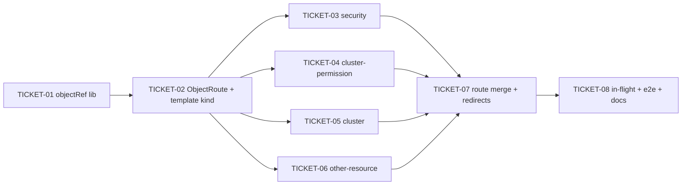

# Tasks — Session Object Navigation

> **STATUS:** `sliced` (2026-10-29)

> Sliced from `.skillgrid/specs/2026-10-29-session-object-navigation/blueprint.md`.
> Vertical tracer-bullet tickets, dependency-ordered, sized for one fresh
> agent context window.

## Epic Summary

Replace the SPA's query-string object navigation with tab-private
`sessionStorage` object refs + same-origin form-POST deep links (ADR-0040):
no object identity in the URL, refresh survives in-tab (15-min lazy
expiry), cross-tab share lands on the object via POST, one route per kind
(`/data` suffix dropped), old `/.../data?name=` URLs redirect one-shot.
No backend change, no new dependency. Wide refactor sequenced
expand → migrate batches → contract.

## Delivery Strategy

| Field | Value |
|-------|-------|
| Estimated changed lines | 2500-4000 (37 view files + 3 new modules + App.tsx + 18 test files + e2e) |
| 400-line budget risk | High |
| Chained PRs recommended | Yes |
| Suggested split | PR 1 (lib + template kind) → PR 2 (migrate waves) → PR 3 (contract + docs) |
| Delivery strategy | ask-on-risk |
| Chain strategy | pending |

Decision needed before apply: Yes
Chained PRs recommended: Yes
Chain strategy: pending
400-line budget risk: High

### Suggested Work Units

| Unit | Goal | Likely PR | Focused test command | Runtime harness | Rollback boundary |
|------|------|-----------|----------------------|-----------------|-------------------|
| 1 | objectRef lib + ObjectRoute + ShareObjectButton + priorityclass template kind end-to-end | PR 1 | `cd frontend && corepack pnpm test tests/lib tests/components` | dev-stack (`task dev-stack`) for manual click-through; jsdom for unit | `lib/objectRef.ts`, `components/ObjectRoute.tsx`, `components/ShareObjectButton.tsx`, priorityclass view pair, `tests/lib/objectRef.test.ts`, `tests/components/object_route.test.tsx` — all new files, revert = delete |
| 2 | migrate all kind batches (security, cluster-permission, cluster, other-resource) + route merge in App.tsx + old-URL redirects | PR 2 | `cd frontend && corepack pnpm test tests/views` | dev-stack; `task fe-build` | the 37 migrated view files + `App.tsx` route table + re-pointed view tests; revert = restore views to query-param shape (the redirect layer keeps old URLs working either way) |
| 3 | contract: delete residual identity reads, drop `?selected=`, ADR-0040 flip to accepted, ASSUMPTIONS/ARCHITECTURE update, e2e deep-link + redirect scenarios | PR 3 | `cd frontend && corepack pnpm test && task fe-check` | e2e (kind + Helm) for the deep-link scenario | `Secret.tsx`/`ServiceAccounts.tsx` hint removal, `ASSUMPTIONS.md`, `ARCHITECTURE.md`, `e2e/ui-smoke.spec.ts`, ADR file status line |

> The four plain-text guard lines above are the **contract** —
> `skillgrid:subagent-execution` matches them literally. If risk is High,
> `Chained PRs recommended` MUST be `Yes` and every work unit MUST name a
> focused test, a runtime harness (or `N/A` + reason), and a rollback
> boundary.

## Tickets

### TICKET-01 - objectRef lib + unit tests (RED first)

- **Tracker ID:** TASK-055
- **Scope:** the full `frontend/src/lib/objectRef.ts` module per the
  blueprint contract (registry, active pointer, lazy 15-min expiry, token
  mint, `openObject`, `postObjectToTab`, `consumeIncoming`, `sweepRelay`)
  + `frontend/tests/lib/objectRef.test.ts`.
- **Acceptance:** all `objectRef.test.ts` scenarios green — registry
  round-trip, token uniqueness, backdated-16-min expiry clears the active
  pointer, relay consume + self-delete, expired relay → null, `sweepRelay`
  idempotent. `cd frontend && corepack pnpm test tests/lib` exit 0.
- **SATISFIES:** the open object ref lives in sessionStorage only; an
  expired ref renders the list; a stale relay key is not consumed by a
  plain GET; the relay self-deletes after consumption
- **Files:** `src/lib/objectRef.ts` (new ~150), `tests/lib/objectRef.test.ts` (new ~120)
- **Size:** ~300 (S)
- **Blocks:** TICKET-02
- **Blocked by:** none
- **Fails-when:** `pnpm test tests/lib` exits non-zero or any
  `kd_ref_` key survives a consumed handoff in the test assertions

### TICKET-02 - ObjectRoute + ShareObjectButton + priorityclass template kind

- **Tracker ID:** TASK-056
- **Scope:** `src/components/ObjectRoute.tsx` (kind-matched list/detail
  render, mount-time `consumeIncoming` + `sweepRelay`, navigate-seam
  registration) + `src/components/ShareObjectButton.tsx` + migrate
  `OtherResource/PriorityClass.tsx` (link producer → `openObject` click)
  and `OtherResource/PriorityClassData.tsx` (`useSearchParams` → props
  from ObjectRoute) + wire BOTH routes in `App.tsx` ALONGSIDE the existing
  `/other-resource/priorityclass/data` route (expand, not contract) +
  `tests/components/object_route.test.tsx` + re-point
  `tests/views/priority_classes.test.tsx` / `priority_class_data.test.tsx`.
- **Acceptance:** clicking a priorityclass name renders the data view with
  `window.location.search === ''` (R1); a ref for kind `secret` on the
  priorityclass route renders the list (R6); share button submits a hidden
  form POST with a token body (no `name=`/`namespace=` in the action URL)
  (R4); `pnpm test tests/components tests/views/priority_class*` exit 0;
  `task fe-build` green.
- **SATISFIES:** opening an object from a list leaves the URL clean; one
  route per kind - detail renders only for a matching ref; the share
  action opens the object in a new tab with a clean URL
- **Files:** `src/components/ObjectRoute.tsx` (new ~80), `src/components/ShareObjectButton.tsx` (new ~30), `src/views/OtherResource/PriorityClass.tsx`, `src/views/OtherResource/PriorityClassData.tsx`, `src/App.tsx` (2 route entries), `tests/components/object_route.test.tsx` (new ~100), `tests/views/priority_classes.test.tsx`, `tests/views/priority_class_data.test.tsx`
- **Size:** ~600 (M)
- **Blocks:** TICKET-03, TICKET-04, TICKET-05, TICKET-06
- **Blocked by:** TICKET-01
- **Precondition:** TICKET-01 committed — `src/lib/objectRef.ts` exists and `pnpm test tests/lib` is green
- **Fails-when:** `pnpm test tests/components tests/views/priority_class*` exits non-zero, or the rendered data page's `location.search` is not `''`, or `task fe-build` fails

### TICKET-03 - migrate security views (secret, network-policy)

- **Tracker ID:** TASK-057
- **Scope:** `Security/Secret.tsx`, `Security/SecretData.tsx`,
  `Security/NetworkPolicy.tsx`, `Security/NetworkPolicyData.tsx` →
  ObjectRoute contract. Secret: drop the `?selected=` hint (R9) — bolding
  reads `getActiveRef()`. NetworkPolicy: `?kind=`/`?type=` stay filters
  (R9); identity via ref. The R8 test (header `default`, ref `team-a` →
  read `team-a`) lands in `tests/views/secrets.test.tsx`.
- **Acceptance:** clicking a secret/policy name renders the data view with
  `location.search === ''`; with the header on `default` and a ref for
  `team-a`, the API read is for `team-a`; no `?selected=` in any produced
  URL; `pnpm test tests/views/secrets* tests/views/network_polic*` exit 0.
- **SATISFIES:** the ref's namespace wins over the header selector; the
  selected bolding hint is replaced by the active ref; a genuine filter
  param may remain a query param
- **Files:** `src/views/Security/Secret.tsx`, `SecretData.tsx`, `NetworkPolicy.tsx`, `NetworkPolicyData.tsx`, `src/App.tsx` (wrap in ObjectRoute), `tests/views/secrets.test.tsx`, `tests/views/network_policies.test.tsx`, `tests/views/network_policy_data.test.tsx`
- **Size:** ~500 (M)
- **Blocks:** none
- **Blocked by:** TICKET-02
- **Fails-when:** `pnpm test tests/views/secrets* tests/views/network_polic*` exits non-zero, or any assertion finds `?name=`/`?namespace=`/`?selected=` in a produced navigation URL

### TICKET-04 - migrate cluster-permission views (SA, role, cluster-role, bindings)

- **Tracker ID:** TASK-058
- **Scope:** `ClusterPermission/ServiceAccounts.tsx`,
  `ServiceAccountData.tsx`, `Role.tsx`, `RoleData.tsx`,
  `ClusterRole.tsx`, `ClusterRoleData.tsx`, `RoleBinding.tsx`,
  `ClusterRoleBinding.tsx` → ObjectRoute contract. The cross-links
  (binding → role/cluster-role/SA, SA → secret data) become `openObject`
  calls with the target kind. The `ServiceAccounts → /security/secret?selected=`
  producer is deleted (R9, paired with TICKET-03's consumer change).
- **Acceptance:** every name cell in the 4 list views opens the matching
  data view via ref with `location.search === ''`; cross-kind links
  (binding → role, SA → secret) resolve to the target kind's detail;
  `pnpm test tests/views/service_accounts* tests/views/roles*
  tests/views/role_bindings* tests/views/cluster_roles*
  tests/views/cluster_role_bindings*` exit 0.
- **SATISFIES:** opening an object from a list leaves the URL clean; one
  route per kind - detail renders only for a matching ref
- **Files:** the 8 view files above, `src/App.tsx` (wrap in ObjectRoute), `tests/views/service_accounts.test.tsx`, `roles.test.tsx`, `role_bindings.test.tsx`, `cluster_roles.test.tsx`, `cluster_role_bindings.test.tsx`
- **Size:** ~700 (M)
- **Blocks:** none
- **Blocked by:** TICKET-02
- **Fails-when:** `pnpm test` over the 5 test files exits non-zero, or a cross-kind link renders the wrong kind's detail

### TICKET-05 - migrate cluster views (namespace, node, crd)

- **Tracker ID:** TASK-059
- **Scope:** `Cluster/Namespaces.tsx`, `NamespaceData.tsx`, `Nodes.tsx`,
  `NodeData.tsx`, `CRDs.tsx`, `CrdData.tsx` → ObjectRoute contract.
  NamespaceData's "`?namespace=` accepted for 4.1 bookmarks" read is
  replaced by the ref (the bookmark path is the R7 redirect instead).
  CrdData's two-call read (CRD + instances) is unchanged in shape — only
  the identity source moves to the ref.
- **Acceptance:** clicking a namespace/node/CRD name renders the data view
  with `location.search === ''`; CrdData still issues its two API calls
  (CRD read + instances read) with the ref's name; `pnpm test
  tests/views/namespaces* tests/views/namespace_data* tests/views/node*
  tests/views/crds*` exit 0.
- **SATISFIES:** opening an object from a list leaves the URL clean; the
  data page never carries identity params
- **Files:** the 6 view files above, `src/App.tsx` (wrap in ObjectRoute), `tests/views/namespaces.test.tsx`, `namespace_data.test.tsx`, `node.test.tsx`, `crds.test.tsx`
- **Size:** ~600 (M)
- **Blocks:** none
- **Blocked by:** TICKET-02
- **Fails-when:** `pnpm test` over the 4 test files exits non-zero, or CrdData's two-call contract is altered

### TICKET-06 - migrate other-resource views (hpa, vpa, pdb, resource-quota, limit-range) + runtimeclass

- **Tracker ID:** TASK-060
- **Scope:** `OtherResource/HorizontalPodAutoscaler{,Data}.tsx`,
  `VerticalPodAutoscaler{,Data}.tsx`, `PodDisruptionBudget{,Data}.tsx`,
  `ResourceQuota{,Data}.tsx`, `LimitRange{,Data}.tsx`,
  `RuntimeClass{,Data}.tsx` (12 files) → ObjectRoute contract. This is
  the widest batch (10 namespaced + 2 cluster-scoped kinds) but purely
  mechanical once the template kind (TICKET-02) is proven.
- **Acceptance:** every name cell in the 6 list views opens the matching
  data view via ref with `location.search === ''`; the data pages read
  namespace from the ref (R8, no `|| selectedNamespace` fallback);
  `pnpm test tests/views/horizontal_pod_autoscaler*
  tests/views/vertical_pod_autoscaler* tests/views/pod_disruption_budget*
  tests/views/resource_quota* tests/views/limit_range*
  tests/views/runtime_class*` exit 0.
- **SATISFIES:** opening an object from a list leaves the URL clean;
  refreshing the tab keeps the open object; the ref's namespace wins over
  the header selector
- **Files:** the 12 view files above, `src/App.tsx` (wrap in ObjectRoute), the 12 matching `tests/views/*` files
- **Size:** ~900 (M)
- **Blocks:** TICKET-07
- **Blocked by:** TICKET-02
- **Fails-when:** `pnpm test` over the 12 test files exits non-zero, or any migrated data view still calls `useSearchParams` for identity

### TICKET-07 - route merge + old-URL redirects in App.tsx (contract for migrated kinds)

- **Tracker ID:** TASK-061
- **Scope:** in `App.tsx`, replace the expanded list+data route pairs with
  single ObjectRoute entries (drop the `/data` suffix routes as primary
  routes) and add the `<OldDataRedirect>` routes (R7): read legacy
  `?name=`/`?namespace=` (+`?kind=`/`?type=` where applicable), hydrate
  the ref with `origin: 'link'`, `<Navigate to="/x/y" replace />`. Apply
  to ALL kinds migrated in TICKET-02..06 (21 routes). Decision (open
  decision 1 in the blueprint): redirect layer is KEPT (default).
- **Acceptance:** the routes table has no `/.../data` primary entry for a
  migrated kind; opening `/security/secret/data?name=db-creds&namespace=team-a`
  lands on the data page at the clean URL with ref origin `link`; back/
  forward still moves list↔detail; `task fe-build` green;
  `pnpm test` (full frontend suite) green.
- **SATISFIES:** an old data URL redirects to the clean route with the ref
  hydrated; back from the detail returns to the list
- **Files:** `src/App.tsx`, `src/components/ObjectRoute.tsx` (redirect helper if needed), `tests/views/*` (any test asserting the old route shape), `tests/App.test.tsx` (new, redirect scenarios)
- **Size:** ~500 (M)
- **Blocks:** TICKET-08
- **Blocked by:** TICKET-03, TICKET-04, TICKET-05, TICKET-06
- **Fails-when:** `pnpm test` full suite exits non-zero, or a legacy URL does not end at the clean route with the data page rendered, or `task fe-build` fails

### TICKET-08 - in-flight spec views + e2e + docs (contract close)

- **Tracker ID:** TASK-062
- **Scope:** (a) verify `2026-10-29-statefulsets-daemonsets-replicasets-views`
  executes to the NEW contract per its `NAVIGATION-SUPERSEDED.md` note
  (its 6 views: statefulsets/daemonsets/replicasets list+data — if not yet
  landed, no action; if landed with query params, migrate them); (b)
  `e2e/ui-smoke.spec.ts`: drop the 14 `/data` entries from the route list,
  add the deep-link scenario (share → new tab renders object,
  `location.search === ''`) + the old-URL redirect scenario; (c)
  `ARCHITECTURE.md` routing section update; (d) ADR-0040 status flip
  `proposed` → `accepted` + `ASSUMPTIONS.md` row `In force: yes`; (e)
  residual sweep: `grep -r 'useSearchParams' src/views` must show only
  genuine-filter usages (`?labelSelector=`, `?kind=`, `?type=`);
  `grep -r 'data?name=' src/` returns nothing.
- **Acceptance:** `grep -rn 'data?name=' frontend/src` → 0 matches;
  `grep -rln 'useSearchParams' frontend/src/views` lists only files with a
  genuine filter param; e2e deep-link + redirect scenarios pass under
  kind+Helm; `task fe-build` + `task fe-check` green; ADR-0040 file
  `status: "accepted"`; `ASSUMPTIONS.md` row in-force.
- **SATISFIES:** no new endpoint serves the object selection; an old data
  URL redirects to the clean route with the ref hydrated (e2e-level
  proof); the share action opens the object in a new tab with a clean URL
  (e2e-level proof)
- **Files:** `frontend/e2e/ui-smoke.spec.ts`, `.skillgrid/ARCHITECTURE.md`, `.skillgrid/knowledge/decisions/04-adr-0040-session-object-navigation.md`, `.skillgrid/ASSUMPTIONS.md`, the 6 in-flight-spec views if landed with query params, their tests
- **Size:** ~400 (S/M)
- **Blocks:** none
- **Blocked by:** TICKET-07
- **Fails-when:** `grep -rn 'data?name=' frontend/src` prints any line, or e2e scenarios fail, or `task fe-check` fails

## Dependency Graph

## Execution Order

- **Wave 1:** TICKET-01
- **Wave 2:** TICKET-02 (after TICKET-01)
- **Wave 3 (parallel worktrees):** TICKET-03, TICKET-04, TICKET-05,
  TICKET-06 (all after TICKET-02; they touch disjoint view folders —
  `App.tsx` edits are additive wraps only, no route removal)
- **Wave 4:** TICKET-07 (after all of Wave 3)
- **Wave 5:** TICKET-08 (after TICKET-07)

> **Acceptance-first (BDD is always on):** a ticket's failing acceptance
> scenario (its `SATISFIES` scenario) is written and confirmed RED *before*
> the implementation that makes it green. TICKET-01's unit tests ARE the
> RED phase for the lib; each migration ticket re-points its view tests
> RED (asserting `location.search === ''` + ref-driven render) before the
> view code changes.

## Slicing Notes

- **Wide-refactor sequence (expand → migrate → contract):** TICKET-02
  EXPANDS (the template kind runs ObjectRoute ALONGSIDE its old `/data`
  route); TICKET-03..06 MIGRATE (additive wraps in `App.tsx`, old routes
  still present); TICKET-07 CONTRACTS (drops the `/data` primary routes,
  keeps them as redirect routes); TICKET-08 closes the contract
  (residual sweep + docs).
- **Wave 3 parallelism is safe** because the four batches touch disjoint
  `src/views/<Folder>` sets; their `App.tsx` edits are independent
  additive route wraps (one per kind), and the contract (route removal)
  is deferred to TICKET-07 to avoid merge conflicts on the route table.
- **The in-flight spec** (statefulsets/daemonsets/replicasets, 2026-10-29)
  is handled in TICKET-08, not as a parallel batch: it is still executing,
  and its `NAVIGATION-SUPERSEDED.md` note already tells its executor to
  build to the new contract — TICKET-08 only verifies/migrates if it
  landed on the old shape first.
- **Stub kinds are out of scope** (configmap, pvc, volumesnapshot,
  storageclass, snapshotclass, service, ingress,
  ingressclass/gatewayclass): their specs' `NAVIGATION-SUPERSEDED.md`
  markers tell their executors to build to this contract directly.
- **Assumption:** `KubeDataTable`'s column render API accepts a
  click-handler cell (button, not `<Link>`) without a table-level API
  change — verified against the component in TICKET-02; if it needs a
  small prop addition, that lands in TICKET-02 (it is the template).
- **Chain strategy is `pending`** (ask-on-risk): the executor asks the
  user at apply time between `stacked-to-main` and `feature-branch-chain`.
