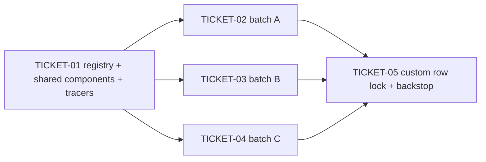

# Tasks — Frontend Kind Registry (Generated Routes + Shared List/Data Views)

> **STATUS:** `sliced` (2026-11-07)

> Sliced from `.skillgrid/specs/2026-11-07-frontend-kind-registry/blueprint.md`.
> Wide refactor sequenced expand (registry + tracers) → migrate
> (per-folder batches) → contract (custom-row lock + backstop), sized for
> one fresh agent context window.

## Epic Summary

One typed registry (`src/lib/kinds.ts`) owns every standard kind's route /
plural / titles / legacy-redirect / custom flag; `App.tsx` renders its
resource routes from the registry instead of 39 hand-unrolled blocks
(21 `ObjectRoute` + 18 `OldDataRedirect`). The 13 fully-standard view pairs
+ the role/clusterrole list-find pairs become thin config wrappers over
`ResourceListView` / `ResourceDataView` (data variants: single-fetch /
list-find); the 8 divergent sides keep hand-rolled views; the 3 custom
dispatcher routes stay explicit. No behaviour change: titles byte-identical,
one lazy chunk per view, legacy `/data` redirects intact where shipped.

## Delivery Strategy

| Field | Value |
|-------|-------|
| Estimated changed lines | 4000-4500 (4 new src modules + 4 new test modules + ~35 view files + `App.tsx` + ~25 test file re-points) |
| 400-line budget risk | High |
| Chained PRs recommended | Yes |
| Suggested split | PR 1 (registry + shared components + 2 tracers) → PR 2 (migrate batches A/B/C) → PR 3 (custom-row lock + e2e backstop) |
| Delivery strategy | ask-on-risk |
| Chain strategy | pending |

Decision needed before apply: Yes
Chained PRs recommended: Yes
Chain strategy: pending
400-line budget risk: High

### Suggested Work Units

| Unit | Goal | Likely PR | Focused test command | Runtime harness | Rollback boundary |
|------|------|-----------|----------------------|-----------------|-------------------|
| 1 | registry + `ResourceListView`/`ResourceDataView`/`ResourceRoute` + generator + limitrange/role tracers end-to-end (door check) | PR 1 | `cd frontend && corepack pnpm test tests/lib tests/components` | dev-stack (`task dev-stack`) click-through on both tracers; jsdom for unit | new files `src/lib/kinds.ts`, `src/components/Resource{ListView,DataView,Route}.tsx`, 4 new test modules + the limitrange/role view pairs + the `App.tsx` generator — revert = delete new files, restore tracers |
| 2 | migrate batches A/B/C (the remaining 22 standard kinds across `Cluster/` `ClusterPermission/` `Security/` `Network/` `OtherResource/` `Storage/`) + `App.tsx` block deletions | PR 2 | `cd frontend && corepack pnpm test tests/views` | dev-stack; `task fe-build` | the converted view files + the `App.tsx` route table + re-pointed view tests; revert = restore view files and the 20 hand blocks |
| 3 | custom-row lock (path literals → row lookups) + jscpd clone check + chunk diff + full e2e title backstop | PR 3 | `cd frontend && corepack pnpm test && task e2e` | e2e (kind + Helm) for the 5 view-derived strings | the 3 `App.tsx` custom-block edits only — revert restores the path literals |

> The four plain-text guard lines above are the **contract** —
> `skillgrid:subagent-execution` matches them literally. If risk is High,
> `Chained PRs recommended` MUST be `Yes` and every work unit MUST name a
> focused test, a runtime harness (or `N/A` + reason), and a rollback
> boundary.

## Tickets

### TICKET-01 - registry + shared components + generator + limitrange and role tracers (door check)

- **Tracker ID:** TASK-080
- **Scope:** the full `frontend/src/lib/kinds.ts` (`KindSpec` + ALL 24 rows:
  21 standard + 3 custom, transcribed from the `App.tsx` `ObjectRoute` /
  `OldDataRedirect` blocks + each view's `CCardTitle` verbatim + each view's
  fetch URL plural; `legacyData: false` on the 6 storage rows;
  `clusterScoped` from `OldDataRedirect`) + `ResourceListView` (card +
  breadcrumb + TanStack Query fetch + `KubeDataTable` + `openObject` row
  wiring) + `ResourceDataView` (single-fetch AND list-find variants) +
  `ResourceRoute`/`LegacyDataRoute` (both wrapping content in
  `ProtectedRoute`) + the `App.tsx` generator (all 21 standard route pairs;
  no `/data` route where `legacyData` is false) + convert the two tracers
  `LimitRange{,Data}.tsx` (single-fetch) and `Role{,Data}.tsx` (list-find)
  to thin wrappers + delete the limitrange + role hand blocks +
  `tests/lib/kinds.test.ts` (registry invariants, RED first) +
  `tests/components/resource-list-view.test.tsx` +
  `tests/components/resource-data-view.test.tsx` (RED first) + shared
  `KubeDataTable` test fake extracted for the component tests + re-point
  `limit_ranges` / `limit_range_data` / `roles` view tests (pass the
  registry row's `spec` in `renderAt`).
- **Acceptance:** `corepack pnpm test` + `task fe-build` + `task fe-check`
  green; `kinds.test.ts` invariants green (unique routes, expected-kinds set
  fixture, shared-rendered ⇔ factory absent, `legacyData: false` only on the
  6 storage rows, custom rows factory-free with non-empty `kinds`); the 3
  unit title pins green **unedited**; `dist/assets/` still contains separate
  `LimitRange*` + `Role*` chunks (chunk names recorded in the commit body);
  zero per-kind branches inside the shared components.
- **SATISFIES:** the registry rows are keyed by kind with unique routes; the
  registry standard-kind set matches the app route table; the registry rows
  carry verbatim titles and non-empty plurals; the registry marks
  legacy-data false only for the six storage kinds; a registry side is
  shared-rendered exactly when its factory is absent; standard kind routes
  are generated from the registry; the six storage kinds emit no legacy
  data redirect route; adding a standard kind requires no App.tsx edit; the
  shared list view opens the data view via openObject on the same route; the
  shared data view renders detail with a muted not-found state; the shared
  data view shows a muted not-found state on a miss; the list-find data
  variant fetches the full list and finds client-side; the tracer kinds
  render end-to-end through the generated registry; the converted tracer
  views keep one chunk each; the door-check unit title pins stay green
  unedited
- **Files:** `src/lib/kinds.ts` (new ~200), `src/components/ResourceListView.tsx` (new ~120), `src/components/ResourceDataView.tsx` (new ~150), `src/components/ResourceRoute.tsx` (new ~60), `src/App.tsx` (generator ~40, -2 blocks ~60), `src/views/OtherResource/LimitRange.tsx`, `LimitRangeData.tsx`, `src/views/ClusterPermission/Role.tsx`, `RoleData.tsx`, `tests/lib/kinds.test.ts` (new ~120), `tests/components/resource-list-view.test.tsx` (new ~100), `tests/components/resource-data-view.test.tsx` (new ~120), `tests/components/kube-data-table-fake.tsx` (new ~40), `tests/views/limit_ranges.test.tsx`, `limit_range_data.test.tsx`, `roles.test.tsx`
- **Size:** ~1500 (L)
- **Blocks:** TICKET-02, TICKET-03, TICKET-04
- **Blocked by:** none
- **Fails-when:** `corepack pnpm test` exits non-zero, or a title pin
  assertion was edited, or a `LimitRange*` / `Role*` chunk is missing from
  `dist/assets/` after `task fe-build`

  **Door check (blueprint stop condition):** any per-kind branch required
  inside a shared component, a lost split chunk, or an edited title pin →
  stop and report, user decides. This ticket is the go/no-go for the whole
  change.

### TICKET-02 - batch A - serviceaccount clusterrole namespace node crd

- **Tracker ID:** TASK-081
- **Scope:** blueprint Task 2 — `ClusterRole{,Data}.tsx` → thin wrappers
  (shared list + list-find data; the rule table moves into `detail`);
  `ServiceAccounts.tsx` + `CRDs.tsx` → list wrappers only (`ServiceAccountData.tsx` /
  `CrdData.tsx` stay hand-rolled, take `spec` for the `kind`/`plural`-driven
  fetches); `namespace` / `node` route-coverage only (both views stay
  hand-rolled — the TopMenu admin button / delete column / rollup tiles /
  second `/metrics/*` query stay in the views; the row factories point at
  them); delete the 5 remaining hand blocks from `App.tsx` (serviceaccount,
  clusterrole, namespace, node, crd — the role block was deleted in
  TICKET-01); re-point the batch's view tests where a view gains `spec`.
- **Acceptance:** `corepack pnpm test && task fe-build && task fe-check`
  green; clusterrole renders the shared list + list-find data via the
  generated route; serviceaccount/crd render shared lists with hand-rolled
  data views; namespace/node render their hand-rolled views through the
  registry lazy factories; legacy `/data` redirects for these routes behave
  as today; zero title-assertion edits.
- **SATISFIES:** batch A kinds render through the generated registry;
  custom-rendered sides keep their hand-rolled behaviour
- **Files:** `src/views/ClusterPermission/ClusterRole.tsx`, `ClusterRoleData.tsx`, `ServiceAccounts.tsx`, `ServiceAccountData.tsx`, `src/views/Cluster/CRDs.tsx`, `CrdData.tsx`, `src/App.tsx` (-5 blocks), `tests/views/cluster_roles.test.tsx`, `service_accounts.test.tsx`, `crds.test.tsx` (+ `namespaces` / `namespace_data` / `nodes` tests — unchanged, their views take no `spec`)
- **Size:** ~900 (M)
- **Blocks:** none
- **Blocked by:** TICKET-01
- **Fails-when:** `corepack pnpm test` exits non-zero, or a title assertion
  was edited, or `task fe-build` fails

### TICKET-03 - batch B - secret six standard kinds and service

- **Tracker ID:** TASK-082
- **Scope:** blueprint Task 3 — `Secret.tsx` → shared list wrapper
  (`SecretData.tsx` stays hand-rolled: reveal/clipboard, no JSON, red
  not-found; takes `spec` for its fetch) + the 6 fully-standard pairs
  `PriorityClass{,Data}`, `RuntimeClass{,Data}`, `ResourceQuota{,Data}`,
  `PodDisruptionBudget{,Data}`, `VerticalPodAutoscaler{,Data}`,
  `HorizontalPodAutoscaler{,Data}` → thin wrappers + **`Service{,Data}.tsx`
  → thin wrappers (folded in here — see Slicing Notes: the blueprint's
  batch lists omit `service` although the registry locks it and Task 5
  asserts all 13 fully-standard pairs converted)** + delete the 8 hand
  blocks from `App.tsx` (secret, priorityclass, runtimeclass, resourcequota,
  poddisruptionbudget, verticalpodautoscaler, horizontalpodautoscaler,
  service).
- **Acceptance:** `corepack pnpm test && task fe-build && task fe-check`
  green; secret renders the shared list + hand-rolled data via the
  generated route; the 7 fully-standard pairs (incl. service) render shared
  list + data; legacy `/data` redirects for these routes behave as today;
  zero title-assertion edits.
- **SATISFIES:** batch B kinds render through the generated registry;
  custom-rendered sides keep their hand-rolled behaviour
- **Files:** `src/views/Security/Secret.tsx`, `SecretData.tsx`, `src/views/Network/Service.tsx`, `ServiceData.tsx`, `src/views/OtherResource/PriorityClass{,Data}.tsx`, `RuntimeClass{,Data}.tsx`, `ResourceQuota{,Data}.tsx`, `PodDisruptionBudget{,Data}.tsx`, `VerticalPodAutoscaler{,Data}.tsx`, `HorizontalPodAutoscaler{,Data}.tsx` (12), `src/App.tsx` (-8 blocks), the matching `tests/views/*` test files (re-point `spec` where a view gains one — incl. `services` / `service_data`)
- **Size:** ~1100 (M)
- **Blocks:** none
- **Blocked by:** TICKET-01
- **Fails-when:** `corepack pnpm test` exits non-zero, or a title assertion
  was edited, or `task fe-build` fails

### TICKET-04 - batch C - storage kinds without legacy data redirects

- **Tracker ID:** TASK-083
- **Scope:** blueprint Task 4 — the 5 fully-standard pairs
  `StorageClass{,Data}`, `ConfigMap{,Data}`, `SnapshotClass{,Data}`,
  `VolumeSnapshot{,Data}`, `Pvc{,Data}` → thin wrappers; `Pv.tsx` stays
  hand-rolled (claim filter + `/metrics/pvcs` join + status/usage cells —
  the row's `list` factory points at the hand-rolled view; the shared
  component is not involved), `PvData.tsx` → shared data wrapper; all 6
  rows carry `legacyData: false` → the generator emits no `/data` route for
  any of them; delete the 6 hand blocks from `App.tsx`.
- **Acceptance:** `corepack pnpm test && task fe-build && task fe-check`
  green; the 6 kinds render via the generated routes with **no** `/data`
  redirect route for any; the PV usage-join tests (the faithful
  `KubeDataTable` fake in `pvs.test.tsx`) pass; zero title-assertion edits.
- **SATISFIES:** batch C storage kinds render without legacy data redirects;
  custom-rendered sides keep their hand-rolled behaviour
- **Files:** `src/views/Storage/StorageClass{,Data}.tsx`, `ConfigMap{,Data}.tsx`, `SnapshotClass{,Data}.tsx`, `VolumeSnapshot{,Data}.tsx`, `Pvc{,Data}.tsx`, `PvData.tsx` (11; `Pv.tsx` unchanged), `src/App.tsx` (-6 blocks), `tests/views/pvs.test.tsx`, `pvcs.test.tsx`, `storage_classes.test.tsx`, `configmaps.test.tsx`, `snapshot_classes.test.tsx`, `volume_snapshots.test.tsx` (+ data tests re-pointed where a view gains `spec`)
- **Size:** ~800 (M)
- **Blocks:** none
- **Blocked by:** TICKET-01
- **Fails-when:** `corepack pnpm test` exits non-zero, or a `/data` route
  exists for any of the six storage kinds after cutover, or a title
  assertion was edited, or `task fe-build` fails

### TICKET-05 - custom row lock + clone family gone + e2e title backstop

- **Tracker ID:** TASK-084
- **Scope:** blueprint Task 5 — in `App.tsx`, the 3 custom route blocks
  (ingress, ingress-class, network-policy dispatchers) read their path
  strings from their registry rows (path literals → row lookups; the list
  views' `LIST_ROUTE` constants stay untouched — change C rewires the
  dispatcher routes); jscpd clone check (`npx jscpd --reporters ai --summary`
  over `frontend/src/views`) — the per-view clone family among
  shared-rendered kinds (~104L `*Data.tsx` pairs, 13 standard + 2 list-find)
  is gone; `vite build` chunk list diff for ALL converted kinds (one chunk
  per view file); full floor: `corepack pnpm test` (all 8 unit title pins
  unedited) + `task fe-build` + `task fe-check` + `task e2e` (the 5
  view-derived strings unedited); record both jscpd and chunk before/afters
  in the commit body.
- **Acceptance:** jscpd shows the clone family gone among shared-rendered
  kinds (the 8 custom-rendered sides remain by design); the chunk list shows
  one chunk per converted view file; `grep -c '<ObjectRoute' src/App.tsx` +
  `grep -c '<OldDataRedirect' src/App.tsx` count only the named out-of-scope
  blocks (cert-manager/ELB dispatchers, role-binding/cluster-role-binding) —
  no standard kind; `task e2e` green with the 5 strings unedited; `App.tsx`
  < ~700 lines.
- **SATISFIES:** the custom dispatcher routes read their paths from the
  registry; the per-view clone family is gone among shared-rendered kinds;
  the hand-unrolled standard route blocks are gone from App.tsx; the e2e
  view title strings stay green unedited
- **Files:** `src/App.tsx` (the 3 custom blocks)
- **Size:** ~200 (S)
- **Blocks:** none
- **Blocked by:** TICKET-02, TICKET-03, TICKET-04
- **Fails-when:** `corepack pnpm test` or `task e2e` exits non-zero, or a
  title assertion was edited, or two converted view files share a chunk, or
  a standard-kind hand block remains in `App.tsx`

## Dependency Graph

## Execution Order

- **Wave 1:** TICKET-01 (door check — stop condition: per-kind branch
  inside a shared component, lost chunk, or edited title pin → user decides)
- **Wave 2 (parallel worktrees):** TICKET-02, TICKET-03, TICKET-04 (all
  after TICKET-01; they touch disjoint view folders — `Cluster/` +
  `ClusterPermission/` vs `Security/` + `Network/`[Service only] +
  `OtherResource/` vs `Storage/` — and delete disjoint `App.tsx` blocks)
- **Wave 3:** TICKET-05 (after all of Wave 2)

> **Acceptance-first (BDD is always on):** a ticket's failing acceptance
> scenario (its `SATISFIES` scenario) is written and confirmed RED *before*
> the implementation that makes it green. TICKET-01's `kinds.test.ts` +
> shared-component tests ARE the RED phase (written failing first per
> blueprint Steps 1 and 3); each batch ticket re-points its view tests RED
> (registry-driven `spec` in `renderAt`) before the view code changes.

## Slicing Notes

- **Wide-refactor sequence (expand → migrate → contract):** TICKET-01
  EXPANDS (the generator emits all 21 standard route pairs alongside the
  remaining hand blocks; the 2 tracers cut over, their blocks deleted).
  TICKET-02..04 MIGRATE (each batch converts its kinds and deletes its own
  hand blocks — the generated routes take over). TICKET-05 CONTRACTS (the
  custom blocks' path literals become registry row lookups; clone family +
  title backstop verified).
- **Blueprint gap folded in:** the registry locks `service` in the 21
  standard rows (the expected-kinds fixture) and blueprint Task 5 asserts
  ALL 13 fully-standard pairs converted, but no batch lists `service` — its
  `Network/Service{,Data}.tsx` pair + `App.tsx` block are folded into
  TICKET-03 (the fully-standard batch; `Network/` stays disjoint from
  batches A/C, which touch no `Network/` file other than the untouched
  custom rows). Without this, Task 5's jscpd check and the "App.tsx < ~700
  lines" success criterion cannot pass.
- **Role in batch A:** the blueprint lists `role` in batch A, but
  TICKET-01 already converts `Role{,Data}.tsx` and deletes its block (the
  list-find tracer). TICKET-02 therefore covers the 5 remaining kinds in
  that group; "batch A" keeps the blueprint's 6-kind identity for
  traceability.
- **Duplicate routes during the migrate waves:** the generator emits all 21
  pairs from TICKET-01; until each batch deletes its hand blocks, a hand
  block and its generated duplicate coexist — react-router takes the first
  match, so the generated routes must sit AFTER the hand blocks in
  `App.tsx`; each batch's green gate (`corepack pnpm test`) proves no
  behaviour change as blocks are deleted.
- **Wave 2 parallelism is safe** because the three batches touch disjoint
  `src/views/<Folder>` sets and delete disjoint `App.tsx` route blocks (no
  shared lines); no batch touches `src/lib/kinds.ts` (all rows are
  transcribed in TICKET-01).
- **TICKET-01 is the one oversized ticket** (~17 files, L): the door check
  must be a single state with a single verdict (stop/report), so the
  registry, both shared components (incl. the list-find variant), the
  generator, and both tracers land together.
- **Fleet `KubeDataTable` test-fake migration is change D, NOT here** —
  this change only extracts the shared fake for the new component tests;
  existing view fakes (e.g. `pvs.test.tsx`'s faithful fake) stay as-is.
- **Out of scope per user decision (2026-11-07):** the cert-manager +
  external-LB dispatcher blocks (8 kinds) and the role-binding /
  cluster-role-binding list-only plain routes stay hand-written in
  `App.tsx` (named remaining blocks, asserted in TICKET-05); the
  `kinds: string[]` navigation seam is change C.
- **Assignment-text note:** the slicing assignment names the registry
  `lib/objectRef.ts`; the blueprint (authoritative, post-critic) places it
  at `frontend/src/lib/kinds.ts` — sliced as written in the blueprint.
- **Chain strategy is `pending`** (ask-on-risk): the executor asks the user
  at apply time between `stacked-to-main` and `feature-branch-chain`.
