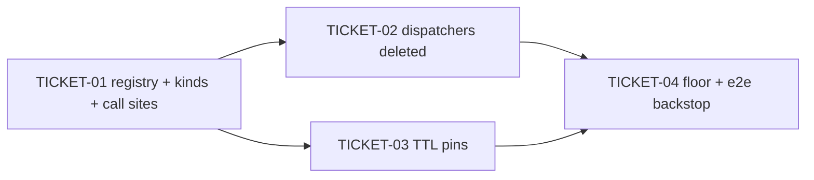

# Tasks — Navigation Seam (Multi-Kind Routes + Kind-Keyed Navigate Registry)

> Waiver: small (waiver in briefing.md)

> **STATUS:** `sliced` (2026-11-07)

> Sliced from `.skillgrid/specs/2026-11-07-navigation-seam/blueprint.md`.
> Light (fast-track small) vertical tracer-bullet tickets, dependency-ordered, sized for one fresh agent context window.

## Epic Summary

The navigate seam moves from a single-slot module global (three writers, last-mount-wins, no unregistration) to a kind-keyed registry in `lib/objectRef.ts`; `ObjectRoute` takes `kinds: string[]` and hands the matched `kind` to `detail`, collapsing the three in-scope hand-rolled dispatchers (network-policy, ingress, ingress-class) into single multi-kind `ObjectRoute` elements. The two out-of-scope dispatchers (cert-manager, external-LB) migrate their seam registrations but stay hand-rolled (B's scope decision). The relay TTL pair is pinned by tests on both sides of the boundary. One documented additive delta: deep links to the converted routes now consume the relay on mount.

## Delivery Strategy

| Field | Value |
|-------|-------|
| Estimated changed lines | 750-1000 (central ~900; ~250 logic + ~650 mechanical one-line test churn - 58 `kind=` sites in 44 files + 5 import moves) |
| 400-line budget risk | High |
| Chained PRs recommended | Yes |
| Suggested split | PR 1 (registry + kinds prop + all call-site migration) → PR 2 (three dispatchers deleted) → PR 3 (TTL pins + floor + e2e backstop) |
| Delivery strategy | ask-on-risk |
| Chain strategy | pending |

Decision needed before apply: Yes
Chained PRs recommended: Yes
Chain strategy: pending
400-line budget risk: High

### Suggested Work Units

| Unit | Goal | Likely PR | Focused test command | Runtime harness | Rollback boundary |
|------|------|-----------|----------------------|-----------------|-------------------|
| 1 | kind-keyed registry + `kinds: string[]` breaking prop + all call-site migration (incl. the 44 test files) | PR 1 | `cd frontend && corepack pnpm test tests/lib tests/components` | jsdom (Vitest + RTL) + `task fe-build` | `src/lib/objectRef.ts` registry block, `src/components/ObjectRoute.tsx` prop/lifecycle, the re-pointed call sites — revert as one unit (the old single-slot global returns with the ObjectRoute.tsx hunks) |
| 2 | three in-scope dispatchers deleted; three converted multi-kind `ObjectRoute` elements + regression tests | PR 2 | `cd frontend && corepack pnpm test tests/App.test.tsx tests/components tests/views/ingress* tests/views/network_polic* tests/views/certmanager* tests/views/external_loadbalancer*` | jsdom (Vitest + RTL) + `task fe-build` | the three deleted dispatcher components + the three rewritten route blocks in `App.tsx` + the new route tests — restore the dispatchers and their old route blocks to roll back |
| 3 | pinned relay-TTL tests both sides + verification floor + e2e backstop | PR 3 | `cd frontend && corepack pnpm test && cd backend && uv run pytest -m "not integration"` then `task e2e` | e2e (kind + Helm) | the two pin test functions (`tests/lib/objectRef.test.ts`, `backend/tests/api/test_object_handoff.py`) — revert = delete them |

> The four plain-text guard lines above are the **contract** — `skillgrid:subagent-execution` matches them literally. If risk is High, `Chained PRs recommended` MUST be `Yes` and every work unit MUST name a focused test, a runtime harness (or `N/A` + reason), and a rollback boundary.

## Tickets

### TICKET-01 - kind-keyed navigate registry + ObjectRoute kinds (breaking prop, all call sites migrated)

- **Tracker ID:** TASK-085
- **Scope:** kind-keyed registry in `src/lib/objectRef.ts` (`NavigateFn`, `registerNavigate(kinds, fn)`, `unregisterNavigate(kinds, fn)` removing only entries still pointing at your own fn, `getNavigateFor(kind)`) + `ObjectRoute` takes `kinds: string[]`, kind-matched `detail` receives the matched `kind`, register-on-mount/unregister-on-unmount, the single-slot global + `getRegisteredNavigate` + the `registerNavigate` re-export deleted; all call sites migrated in the same change — App.tsx (the 5 dispatcher registrations, incl. the 2 out-of-scope, whose kinds arrays come from App.tsx:283-287 / :328-332 + each effect gains the matching cleanup; + any remaining direct `ObjectRoute` sites post-B, at most the `service` block), `ResourceRoute` → `kinds={[spec.kind]}`, test side: the 58 `kind=` sites in the 44 test files + the 5 `registerNavigate` imports move to `lib/objectRef.ts` with two-arg calls (record both file counts in the commit body); `object_route.test.tsx` rewritten for `kinds` + the keyed registry (incl. unmount-unregister); `objectRef.test.ts` registry tests (failing first).
- **Acceptance:** `corepack pnpm test && task fe-build && task fe-check` exit 0 (tsc proves the breaking prop is fully migrated — no `kind=` survives) and `grep -rn "registeredNavigate\|getRegisteredNavigate" frontend/src` → zero hits.
- **SATISFIES:** registering for one kind leaves other kinds intact; re-registering a kind replaces only that kind's fn; unmounting removes only the fn the route registered; after the last route for a kind unmounts the lookup is empty; the route table's kind sets are disjoint; a matching ref renders the detail on a multi-kind route; a foreign-kind ref renders the list; detail receives the matched kind as a param; a single-kind route passes its own kind to detail; the out-of-scope dispatchers register through the kind-keyed API; relay consumption on single-kind routes is unchanged; the single-slot navigate global is gone
- **Files:** `src/lib/objectRef.ts`, `src/components/ObjectRoute.tsx`, `src/App.tsx`, `src/components/ResourceRoute.tsx`, the 44 test files, `tests/lib/objectRef.test.ts`, `tests/components/object_route.test.tsx`
- **Size:** ~465 (M)
- **Blocks:** TICKET-02, TICKET-03
- **Blocked by:** none (Change B landed — cross-change, see Slicing Notes)
- **Fails-when:** `pnpm test` exits non-zero, or `task fe-build` fails, or the grep for the old global prints a hit

### TICKET-02 - three dispatchers deleted: multi-kind ObjectRoute elements

- **Tracker ID:** TASK-086
- **Scope:** in `App.tsx`, the three route blocks become single `ObjectRoute` elements — `/security/network-policy` → `kinds={['NetworkPolicy','CiliumNetworkPolicy','CiliumClusterwideNetworkPolicy']}` with `detail` switching on `p.kind`; `/network/ingress` → `kinds={['ingress','gateway','httproute','referencegrant']}` with `detail` switching ingress vs GatewayApi; `/network/ingress-class` → `kinds={['ingressclass','gatewayclass']}` with `detail` switching — the three dispatcher components deleted, `listRoute` sourced from B's `KINDS` route data; the cert-manager/external-LB components untouched (B's scope decision); regression tests per converted route (the tabbed list renders once, a ref of each kind renders the right detail, a foreign-kind ref renders the list) + the relay-consumption delta mount test (seed the relay + one-shot meta, mount a converted route element, assert the detail renders AND the relay self-deletes — mirroring `object_route.test.tsx:64-89`) + one `OldDataRedirect` `kindFromParam` unit test (fallback kind → detail; foreign `?kind=` → list).
- **Acceptance:** `corepack pnpm test && task fe-build && task fe-check` exit 0 and `grep -rln "NetworkPolicyRoute\|IngressRoute\b\|IngressClassRoute" frontend/src` → zero hits (the components are gone; the cert-manager/ELB test mirrors are untouched).
- **SATISFIES:** the three in-scope dispatchers collapse into single ObjectRoute elements; a ref of each converted kind renders the right detail; cert-manager and external-LB dispatchers stay hand-rolled after the conversion; the kindFromParam legacy redirect is unchanged; a foreign kind param on the legacy redirect renders the list; a deep link to a converted multi-kind route consumes the relay on mount
- **Files:** `src/App.tsx`, the converted routes' test files (discovery: `grep -rln "NetworkPolicyRoute\|IngressRoute\b\|IngressClassRoute" frontend/tests`), `tests/components/object_route.test.tsx` (route-level regression per the blueprint, or a new route test file)
- **Size:** ~400 (M)
- **Blocks:** TICKET-04
- **Blocked by:** TICKET-01
- **Fails-when:** `pnpm test` exits non-zero, or a converted route renders the wrong detail for a kind, or the seeded relay survives the converted-route mount in the delta test

### TICKET-03 - pinned relay TTL tests, both sides

- **Tracker ID:** TASK-087
- **Scope:** frontend pin in `tests/lib/objectRef.test.ts` (`expect(RELAY_TTL_MS).toBe(60_000)`, comment: `// backend/app/core/object_handoff.py STASH_TTL_SECONDS — change both together (ADR-0040 R4 handoff window)`); backend pin in `backend/tests/api/test_object_handoff.py` (`assert STASH_TTL_SECONDS == 60`, comment: `# frontend/src/lib/objectRef.ts RELAY_TTL_MS — change both together (ADR-0040 R4 handoff window)`).
- **Acceptance:** `corepack pnpm test tests/lib/objectRef.test.ts` and `uv run pytest tests/api/test_object_handoff.py -v` both exit 0 with the two pins present; mutating either constant fails the other side's pin (the comments name the counterpart — the pin is bilateral by construction).
- **SATISFIES:** the relay TTL pair is pinned on both sides of the boundary
- **Files:** `frontend/tests/lib/objectRef.test.ts`, `backend/tests/api/test_object_handoff.py`
- **Size:** ~25 (S)
- **Blocks:** TICKET-04
- **Blocked by:** TICKET-01 (same test file — TICKET-01 rewrites its registry tests first)
- **Fails-when:** either pin command exits non-zero, or a pin's comment does not name the counterpart constant

### TICKET-04 - verification floor + e2e backstop + single-slot global proof

- **Tracker ID:** TASK-088
- **Scope:** full floor (`corepack pnpm test` + `task fe-build` + `task fe-check` + `uv run pytest -m "not integration"`) + `task e2e` green (re-scoped per criticC: covers the three converted routes as list-title mounts only; the sole relay-consumption e2e is the single-kind `crd` deep link; the sole old-URL-redirect e2e is `/security/secret/data`; `kindFromParam` is unit-only; row-click→detail has no e2e — unit-only by design) + proof the single-slot global is gone: `grep -rn "registeredNavigate\|getRegisteredNavigate" frontend/src` → zero hits, recorded in the commit body.
- **Acceptance:** all four floor commands exit 0, `task e2e` is green, and the grep prints zero hits.
- **SATISFIES:** the single-slot navigate global is gone; object-navigation e2e is green
- **Files:** none (verification only)
- **Size:** ~10 (S)
- **Blocks:** none
- **Blocked by:** TICKET-02, TICKET-03
- **Fails-when:** any floor command exits non-zero, or any e2e scenario fails, or the grep prints a hit

## Dependency Graph

## Execution Order

- **Wave 1:** TICKET-01
- **Wave 2 (parallel worktrees):** TICKET-02, TICKET-03 (disjoint files — TICKET-02: `App.tsx` + route tests; TICKET-03: the `objectRef.test.ts` pin + the backend test file)
- **Wave 3:** TICKET-04 (after TICKET-02 + TICKET-03)

> **Acceptance-first (BDD is always on):** a ticket's failing acceptance
> scenario (its `SATISFIES` scenario) is written and confirmed RED *before*
> the implementation that makes it green. TICKET-01's registry tests (failing
> first) ARE the RED phase for the seam; TICKET-02 re-points the converted
> routes' tests RED (per-kind detail + the relay delta) before the dispatchers
> are deleted.

## Slicing Notes

- **Cross-change landing order (note only — NOT a ticket blocker):** D dead-code-cleanup → A kind-catalog → B frontend-kind-registry → C (this change). TICKET-01 assumes B has landed: the generated routes exist and `ResourceRoute` is present (its `kinds={[spec.kind]}` update is in TICKET-01's scope).
- **Documented 3-convert / 2-keep asymmetry** (B's scope decision, folded in by criticC): the network-policy, ingress, ingress-class dispatchers are deleted; the cert-manager + external-LB components stay hand-rolled but their seam registrations migrate in TICKET-01 (the breaking API leaves no stragglers).
- **One documented additive delta** (the only behaviour change): deep links to the three converted routes now consume the relay on mount (parity with single-kind routes; none of the five dispatchers did before) — proven by TICKET-02's delta mount test.
- **Line estimate:** ~900 central with the bulk mechanical (58 one-line test call sites + 5 import moves); the logic is ~250 lines — the High risk is churn-driven, hence the 3-PR suggested split (ask-on-risk; chain strategy `pending` until the user chooses at apply time between `stacked-to-main` and `feature-branch-chain`).
- **TICKET-01's 44-file test migration is a single atomic rename step** (tsc enforces completeness — no expand/migrate/contract sequence: the breaking prop has no coexistence window, per the blueprint).
- **TICKET-04 is verification-only** per the blueprint (Task 4); if its grep proof changes nothing it folds into TICKET-03's commit per the blueprint.
- **e2e backstop re-scoped** (criticC): `task e2e` proves the converted routes' list-title mounts only — relay/redirect/`kindFromParam`/row-click coverage is unit-level by design.
